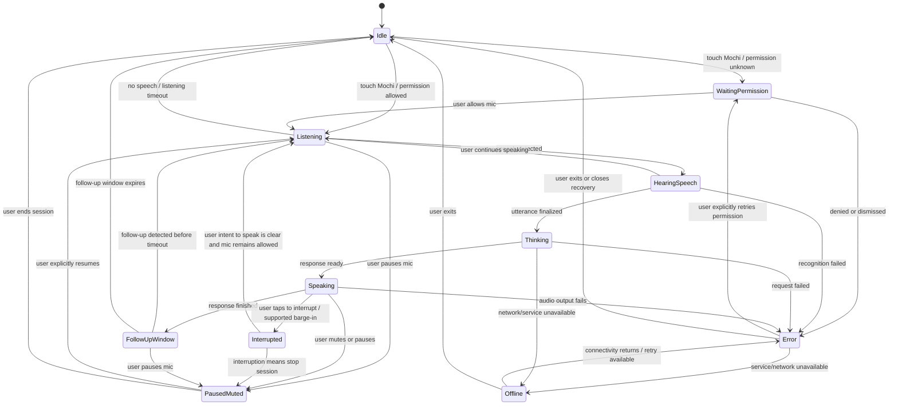

# Mochi AI — UX Journey (Phase 2)

> **الهدف:** تحديد رحلة الاستخدام وسلوك حالات الصوت والشخصية لمساعد صوتي مصري لإدارة اليوم والـ roadmap والتركيز.
>
> **مرجع القرارات:** `00_VISION.md` هو المرجع المعتمد، و`mochi_ai_phase1_research.md` هو ملف البحث المتاح في الحزمة. اسم الملف المذكور في البرومبت (`phase1_references.md`) مختلف عن اسم ملف البحث المرفق؛ اعتُبر الملف الموجود هو المقصود.
>
> **نطاق المستند:** UX journey فقط. لا يتضمن UI styling أو ألوان أو fonts أو art direction أو اختيار tech stack أو code.

## قواعد تجربة ثابتة

- **Baseline هو Level 1:** لمسة مقصودة على Mochi تبدأ الاستماع. Mochi يرد، ويفتح نافذة متابعة قصيرة، ثم يقفل المايك تلقائيًا. بعد انتهاء النافذة، لمسة جديدة مطلوبة لبدء الاستماع من جديد.
- **لا استماع مخفي:** حالة المايك مفهومة وواضحة في كل حالة، ويقدر المستخدم يوقفه فورًا.
- **الصفحة الرئيسية:** Mochi هو العنصر الرئيسي والوحيد. مؤشر حالة المايك استثناء وظيفي صغير مطلوب للخصوصية، وليس Header أو Navbar أو قائمة أو مجموعة أزرار.
- **الموافقة قبل الحفظ:** أي تغيير في الجدول أو مواعيد المهام يُعرض كاقتراح، ثم لا يُحفظ إلا بعد موافقة المستخدم الواضحة.
- **خصوصية الصوت:** الصوت الخام لا يُحفظ أبدًا. النص الناتج عن الكلام لا يُحفظ كملاحظة دائمة إلا إذا اختار المستخدم حفظه. هذا لا يعني أن الصوت يُعالج محليًا؛ مكان المعالجة وإرسال البيانات ما زالا قرارًا مفتوحًا.
- **اللغة:** عامية مصرية طبيعية مع code-switching للمصطلحات التقنية عند الحاجة. الجمل قصيرة ودافئة وغير مؤنِّبة.
- **مستويات التفعيل:** Level 2 (قول «موتشي» بعد فتح جلسة بلمسة) طبقة اختيارية تُختبر لاحقًا، وليست جزءًا من السلوك الأساسي. Level 3 (wake word من غير لمسة، أو استماع بالخلفية/والهاتف مقفول) مؤجل وخارج v1.
- **القيود غير المؤكدة:** أي سلوك يتوقف على المتصفح أو نظام التشغيل أو الـ PWA أو جودة التعرف على اللهجة المصرية يُعلَّم بـ **[needs device test]**.

---

## 1. Journey maps

كل خطوة مكتوبة بالشكل: **User action → What appears → What Mochi says/does → System state**.

### 1.1 First-ever visit — أول زيارة وطلب إذن المايك

1. **المستخدم يفتح Mochi لأول مرة** → تظهر الشخصية فقط مع حالة المايك «متوقف»؛ لا Header ولا Navbar ولا chat history → لا يبدأ الاستماع تلقائيًا → `Sleeping / Idle`.
2. **المستخدم يلمس Mochi** → يظل التركيز على الشخصية ويظهر توضيح لحظي بأن إذن المايك مطلوب؛ يظهر طلب الإذن الأصلي من المتصفح/النظام عند الحاجة → يحاول Mochi الترحيب وشرح السبب بجملة قصيرة، مع caption نصي احتياطي إذا لم يعمل الصوت → `Waiting for permission`.
3. **المستخدم يسمح بالمايك** → يظهر أن المايك جاهز/نشط؛ لا تُضاف قائمة إعدادات للشاشة → يوضح Mochi أنه أصبح جاهزًا لسماع طلب واحد → عند نجاح الإذن يبدأ الاستماع كنتيجة مباشرة للمسة المقصودة → `Listening`.
4. **المستخدم يقول طلبًا بسيطًا، مثل «عايز أرتب يومي»** → يظهر transcript مؤقت قصير للكلام الملتقط عند توفره؛ لا يتحول إلى سجل محادثة دائم → ينتظر Mochi نهاية الكلام ثم يوضح أنه فهم الطلب → `Hearing speech` ثم `Thinking`.
5. **Mochi يرد بخطوة واحدة أو سؤال واحد** → تظل الشخصية هي الأساس، وقد يظهر ملخص صغير للخطوة المقترحة → يرد بصوت إذا كان playback متاحًا، مع caption متزامن؛ لا يبدأ تغييرًا على الجدول وحده → `Speaking`.
6. **تنتهي إجابة Mochi** → تظهر حالة المتابعة ويظل مؤشر المايك موضحًا أنه نشط خلال نافذة المتابعة فقط → ينتظر Mochi ردًا إضافيًا لفترة قصيرة، مبدئيًا نحو 5 ثوانٍ كقيمة قابلة للاختبار، لا كحقيقة مثبتة → `Follow-up window`.
7. **المستخدم يضيف متابعة أو يوافق على اقتراح** → إذا كان هناك تغيير في الجدول، يظهر التغيير المقترح بوضوح قبل الحفظ → يؤكد Mochi ما سيتغير ويطلب موافقة مباشرة إذا لم تكن الموافقة واضحة → `Listening` / `Hearing speech` / `Thinking` بحسب الخطوة.
8. **المستخدم لا يضيف شيئًا وتنتهي نافذة المتابعة** → يعود العرض للشخصية فقط ويصبح المايك متوقفًا بوضوح → يوقف Mochi الاستماع دون محاولة جذب المستخدم لجلسة جديدة → `Sleeping / Idle`.
9. **إذا لم يعمل صوت Mochi بعد السماح بالمايك** → تظهر captions ورسالة قصيرة مع طريق بسيط لإعادة المحاولة أو الكتابة → لا يترك Mochi المستخدم أمام صمت غير مفهوم → `Paused / Muted` أو `Error` بحسب سبب الفشل **[needs device test]**.

**قيد مهم:** طلب إذن المايك وتشغيل صوت الترحيب في نفس التفاعل قد يختلف حسب المتصفح. يجب أن يبقى النص التوضيحي متاحًا حتى لو لم يُسمع الترحيب **[needs device test]**.

### 1.2 Returning visit — زيارة لاحقة والإذن محفوظ

1. **المستخدم يفتح التطبيق** → تظهر Mochi فقط وحالة المايك «متوقف» → لا يتحدث التطبيق ولا يبدأ الاستماع تلقائيًا بمجرد فتح الصفحة → `Sleeping / Idle`.
2. **المستخدم يلمس Mochi** → تتحول الحالة بوضوح إلى الاستماع → يبدأ التقاط الكلام لأن المستخدم أعطى إشارة صريحة → `Listening`.
3. **المستخدم يقول طلبه** → transcript مؤقت قابل للتصحيح عند توفره → يتوقف عن تفسير الكلام عند انتهاء الجملة، ثم يعالج الطلب → `Hearing speech` ثم `Thinking`.
4. **Mochi يقدم ردًا مركزًا** → يظهر فقط ما يساعد على فهم النتيجة، مثل المهمة التالية أو اقتراح موعد → لا يغيّر ترتيب المهام أو الجدول دون موافقة → `Speaking`.
5. **تبدأ نافذة المتابعة القصيرة** → تبقى الحالة واضحة، ولا يُفترض أن المستخدم يعرف من حركة الشخصية وحدها أن المايك نشط → يستقبل Mochi متابعة واحدة أو أكثر داخل النافذة وفق اختبار الاستخدام → `Follow-up window`.
6. **المستخدم يوافق/يرفض أو يترك النافذة تنتهي** → عند الموافقة يُحفظ التغيير المقترح؛ عند الرفض لا يتغير الجدول؛ عند عدم الرد يرجع Mochi إلى idle → يقول Mochi تأكيدًا مقتضبًا للنتيجة، ثم يغلق المايك تلقائيًا → `Speaking` ثم `Sleeping / Idle`.

### 1.3 Installed PWA on phone — استخدام النسخة المثبّتة على الهاتف

1. **المستخدم يفتح أيقونة الـ PWA** → تظهر Mochi، مع المايك متوقفًا في البداية → لا يبدأ التطبيق الاستماع لمجرد الفتح → `Sleeping / Idle`.
2. **المستخدم يلمس Mochi** → يبدأ تدفق Level 1 نفسه الخاص بالويب، إذا كان المتصفح/النظام يسمح به → يؤكد Mochi بداية الجلسة بصوت وcaption عند الإمكان → `Listening` **[needs device test]**.
3. **المستخدم يتكلم بينما الـ PWA في الواجهة الأمامية** → تظهر حالة الاستماع ونتيجة الكلام المؤقتة عند توفرها → يعالج Mochi الطلب بالطريقة المعتادة → `Hearing speech` ثم `Thinking`.
4. **المستخدم ينتقل لتطبيق آخر أو يقفل الشاشة أثناء جلسة** → لا يُفترض استمرار المايك أو الصوت. عند رصد فقدان التركيز/انقطاع الجلسة، تُعرض حالة «الجلسة توقفت» عند رجوع المستخدم → لا يدّعي Mochi أنه كان يسمع في الخلفية → `Paused / Muted` أو `Interrupted by user` **[needs device test]**.
5. **المستخدم يرجع للـ PWA** → تُعرض الحالة الحقيقية فقط؛ إذا انتهت الجلسة لا يُستأنف المايك تلقائيًا → يطلب Mochi لمسة جديدة للمتابعة، ويمكنه تلخيص آخر خطوة محفوظة إن كانت متاحة → `Sleeping / Idle`.
6. **المستخدم يريد إضافة Mochi للشاشة الرئيسية أو استعادة الصوت** → لا تظهر قائمة ثابتة. عند الحاجة فقط تُعرض إرشادات قصيرة مرتبطة بالحالة الحالية → يشرح Mochi حدود الاستماع أثناء قفل الشاشة دون وعود غير مثبتة → `Error` أو `Idle`.

### 1.4 Mic permission denied or revoked — رفض الإذن أو إلغاؤه

1. **المستخدم يرفض إذن المايك أو يغلق نافذة الإذن** → تبقى الشخصية ظاهرة، ويظهر شرح قصير أن الصوت غير متاح حاليًا → لا يكرر Mochi طلب الإذن بإلحاح ولا يتظاهر بأنه يسمع → `Error`.
2. **المستخدم يحاول بدء جلسة أخرى** → يوضَّح أن الإذن مرفوض وأن التفعيل يجب أن يتم من إعدادات الموقع/المتصفح؛ لا تظهر واجهة إعدادات داخلية مصطنعة → يقترح Mochi إعادة المحاولة بعد تعديل الإذن أو الانتقال للكتابة → `Error`.
3. **المستخدم يختار الكتابة** → يظهر حقل كتابة مؤقت عبر affordance مخفي لا يظهر عادة على الشاشة الرئيسية، مثل إشارة حرفية/لمسة بديلة → يستقبل Mochi الأمر كنص ولا يدّعي وجود صوت → `Paused / Muted` أو مسار نصي احتياطي.
4. **المستخدم يغيّر إذن الموقع من إعدادات المتصفح ثم يرجع** → عند التحقق من الإذن، يشرح Mochi الوضع الحالي؛ لا يستأنف الاستماع من غير لمسة → بعد لمسة جديدة، يبدأ الاستماع إذا سمح المتصفح → `Sleeping / Idle` ثم `Listening` **[needs device test]**.
5. **إذا سُحب الإذن أثناء الجلسة** → يتوقف التقاط الصوت فورًا بمجرد معرفة الفشل، وتتغير الحالة إلى غير نشط → لا يعرض «بيسمع» بينما المايك فعليًا غير متاح → `Error`.

### 1.5 Voice not understood / noisy room — الكلام غير مفهوم أو المكان مزعج

1. **المستخدم يلمس Mochi ويتكلم** → مؤشر المايك يوضح الاستماع، ويظهر transcript مؤقت فقط إذا أنتج المحرك نصًا → ينتظر Mochi اكتمال العبارة قبل إصدار حكم على الفهم → `Listening` ثم `Hearing speech`.
2. **التعرف غير واضح أو النص غير منطقي** → يظهر سؤال إصلاح واحد، لا شاشة خطأ تقنية كبيرة → يقول Mochi مثلًا: «مش متأكد إني فهمتك صح… تعيدها بطريقة تانية؟» → `Error` مؤقت أو `Thinking` ثم `Speaking`.
3. **المستخدم يعيد الطلب بعبارة أبسط** → يظهر النص الجديد مؤقتًا بدل افتراض أن القديم صحيح → يعيد Mochi صياغة ما فهمه قبل تنفيذ أي تغيير حساس → `Listening` ثم `Hearing speech` ثم `Thinking`.
4. **يتكرر الفشل للمرة الثانية** → يظهر خيار كتابة مؤقت ومرئي بوضوح، من غير Navbar أو قائمة دائمة → يقول Mochi إن الكتابة ممكنة بدل تكرار نفس المحاولة بلا نهاية → `Paused / Muted` أو `Error` مع مسار كتابة.
5. **الطلب يتضمن موعدًا أو مدة أو اسم مشروع غير واضح** → يعرض Mochi الصيغة التي فهمها ويسأل عن تأكيدها → لا يغيّر التاريخ/المدة اعتمادًا على تخمين → `Thinking` ثم `Speaking`.
6. **المستخدم يقول «لا، قصدي…»** → يحل النص المصحَّح محل التفسير السابق في الجلسة → يعتذر باختصار ويصحح الفهم دون لوم المستخدم → `Interrupted by user` أو `Listening` حسب طريقة المقاطعة.

### 1.6 Offline or service error — انقطاع الإنترنت أو فشل الخدمة

1. **ينقطع الاتصال قبل الطلب أو أثناءه** → تظهر الشخصية مع حالة اتصال/خدمة غير متاحة، ويظل وضع المايك مستقلًا وواضحًا → يشرح Mochi أن المشكلة في الاتصال/الخدمة، وليس بالضرورة في الميكروفون → `Offline`.
2. **المستخدم يبدأ طلبًا أثناء Offline** → إذا لم يكن مسار الصوت قادرًا على العمل دون اتصال، لا يظهر أن الكلام تم فهمه أو حفظه → يقدم Mochi طريق إعادة المحاولة أو الكتابة المؤقتة إن كانت متاحة → `Offline` أو `Error`.
3. **حدث الانقطاع بعد سماع الجملة وقبل ظهور الرد** → إن كان هناك transcript مؤقت بالفعل، يمكن إبقاؤه كمسودة داخل الجلسة فقط؛ لا يُحفظ الصوت الخام ولا يُنفّذ إجراء غير مؤكد → يوضح Mochi أن الطلب لم يُنفذ بعد، ويطلب إعادة الإرسال بعد رجوع الاتصال → `Offline`.
4. **يعود الاتصال** → تظهر إمكانية retry بشكل مؤقت، ولا يعاد تشغيل التسجيل السابق تلقائيًا → يقترح Mochi إعادة المحاولة ويستنى إشارة المستخدم → `Error` ثم `Listening` بعد لمسة جديدة.
5. **حدث خلل من الخدمة وليس الشبكة** → تظهر رسالة عامة قابلة للفهم مع خيار retry والكتابة، دون تفاصيل داخلية أو stack trace → لا يتهم المايك أو المستخدم إذا كان السبب غير معروف → `Error`.

---

## 2. First 30 seconds, moment by moment

الأوقات تقريبية كسيناريو تصميمي وليست نتائج usability test. التوقيت الفعلي لتصاريح المايك، وظهور الصوت، ووقت المعالجة يحتاج اختبارًا على أجهزة حقيقية.

### 2.1 First-ever visit

| Moment | User action | What appears / state | Mochi line or behavior |
|---|---|---|---|
| 0–3 sec | يفتح الصفحة | الشخصية فقط؛ `Sleeping / Idle`؛ المايك متوقف | لا استماع ولا صوت غير مطلوب. |
| 3–6 sec | يلمس Mochi | طلب إذن المايك من المتصفح؛ `Waiting for permission` | «أهلًا، أنا موتشي. محتاج إذن المايك عشان أسمعك.» **[needs device test]** |
| 6–12 sec | يقرأ طلب الإذن ويختار Allow | تظهر حالة المايك الصحيحة؛ `Listening` إذا نجح الإذن | «تمام، كده نقدر نبدأ. قولّي تحب نشتغل على إيه؟» |
| 12–20 sec | يقول طلبًا بسيطًا | transcript مؤقت؛ `Hearing speech` ثم `Thinking` | يترك مساحة للكلام ولا يقاطعه بسرعة. |
| 20–26 sec | ينتظر الرد | الشخصية تعبّر عن التفكير ثم الكلام؛ `Speaking` | «خلّينا نطلع بخطوة واحدة واضحة بدل ما نزحم اليوم.» |
| 26–30 sec | يسمع/يقرأ الخطوة المقترحة | `Follow-up window`؛ المايك نشط مؤقتًا فقط | «إيه أهم حاجة تحب تخلصها النهارده؟» |

**Example Mochi lines (first visit):**

- «أهلًا، أنا موتشي. نبدأ واحدة واحدة؟»
- «اسمح للمايك عشان أسمعك، وتقدر توقفه في أي وقت.»
- «تمام، قولّي إيه اللي شاغل بالك النهارده؟»
- «مش لازم نرتب كل حاجة دلوقتي؛ نختار أول خطوة بس.»
- «لو صوتي مش شغال، هتلاقي الكلام ظاهر وتقدر تكمّل بالكتابة.»

### 2.2 Returning visit

| Moment | User action | What appears / state | Mochi line or behavior |
|---|---|---|---|
| 0–3 sec | يفتح التطبيق | الشخصية فقط؛ `Sleeping / Idle`؛ المايك متوقف | لا يفتح المايك بمجرد الدخول. |
| 3–5 sec | يلمس Mochi | `Listening`؛ حالة المايك تتحدث فورًا | «أنا معاك، قولّي.» |
| 5–12 sec | يقول «عايز أكمل الـ roadmap بتاع امبارح» | transcript مؤقت؛ `Hearing speech` ثم `Thinking` | يحدد أنه فهم طلب استكمال الـ roadmap، أو يسأل عن المشروع إذا كان فيه أكثر من احتمال. |
| 12–20 sec | ينتظر الرد | تظهر خطوة الـ roadmap الحالية أو ملخص قصير؛ `Speaking` | «آخر مرة كنا واقفين عند… تحب نكمل منها؟» إذا كانت المعلومة محفوظة فعلًا. |
| 20–26 sec | يوافق أو يصحح | يعرض Mochi الخطوة التالية؛ أي تغيير في الجدول يبقى اقتراحًا | «أقترح نبدأ بـ… مناسب ليك؟» |
| 26–30 sec | يوافق أو يترك النافذة تنتهي | يحفظ التغيير فقط بعد موافقة واضحة؛ ثم يقفل المايك | يؤكد ما تم، أو يرجع إلى `Sleeping / Idle` من غير ضغط. |

**Example Mochi lines (returning visit):**

- «أهلًا برجوعك. نكمل من آخر نقطة؟»
- «تحب نراجع أولويات النهارده بسرعة؟»
- «أقترح نبدأ بالمهمة دي؛ وقتها مناسب؟»
- «تمام، سجلت التغيير اللي وافقت عليه.»
- «خد وقتك. لما تحب تكمل، المسني ونبدأ تاني.»

---

## 3. Session state machine

### 3.1 Mermaid diagram

### 3.2 State table

| State | How you enter | What the user sees | What Mochi does | How you exit |
|---|---|---|---|---|
| `Sleeping / Idle` | فتح التطبيق، نهاية نافذة المتابعة، إنهاء الجلسة | الشخصية فقط، والمايك متوقف بوضوح | لا يسجل ولا يستمع ولا يتحدث تلقائيًا | لمسة على Mochi؛ أو حالة مؤقتة تطلب استعادة الإذن عند محاولة المستخدم البدء |
| `Waiting for permission` | لمسة أولى مع إذن غير معروف أو retry صريح | الشخصية، شرح موجز، وطلب الإذن الأصلي من المتصفح | ينتظر قرار المستخدم؛ caption بديل إذا تعذر الصوت | `Listening` عند Allow أو `Error` عند الرفض/الإغلاق |
| `Listening` | لمسة مع إذن مسموح، أو follow-up داخل النافذة، أو resume صريح | حالة «المايك نشط/بيسمع» ووسيلة pause واضحة | يستقبل الكلام ضمن جلسة foreground؛ لا يزعم الاستماع في الخلفية | `Hearing speech`، pause، timeout، أو خطأ |
| `Hearing speech` | بداية التقاط كلام أو وصول interim transcript | transcript مؤقت عندما يتوفر، وحالة أن الكلام قيد الالتقاط | ينتظر نهاية العبارة؛ لا ينفذ أمرًا حساسًا اعتمادًا على transcript غير مكتمل | `Thinking` عند final transcript، `Listening` لاستمرار الكلام، أو `Error` |
| `Thinking` | انتهى كلام المستخدم ويُعالج الطلب | إشارة حالة تفهم المستخدم أن Mochi يعالج؛ لا يُعرض نص وهمي على أنه رد نهائي | يجهز إجابة/خطة، ويتحقق من المعلومات المطلوبة؛ لا يحفظ تغيير جدول بعد | `Speaking`، `Offline`، أو `Error` |
| `Speaking` | جاهز الرد | الشخصية، captions، وملخص عملي قصير إذا احتاجه الطلب | يرد؛ يقبل الإيقاف/المقاطعة إن كانت مدعومة؛ لا يستمر بعد إنهاء الجلسة | `Follow-up window`، `Interrupted`، `Paused / Muted`، أو `Error` |
| `Follow-up window` | انتهاء الرد | توضيح أن المايك نشط لفترة قصيرة لالتقاط متابعة | يستقبل متابعة لفترة محدودة فقط؛ التوصية المبدئية 5 ثوانٍ **[needs device test]** | `Listening` إذا بدأ المستخدم، وإلا `Idle` عند انتهاء الوقت، أو pause |
| `Paused / Muted` | المستخدم يوقف المايك/الصوت أو يختار وضعًا صامتًا | حالة «متوقف مؤقتًا»؛ لا تعتمد على اللون أو الحركة وحدهما | لا يلتقط صوتًا. قد تبقى captions متاحة. لا يخلط pause مع إنهاء الجلسة | resume مقصود إلى `Listening`، أو end إلى `Idle` |
| `Interrupted by the user` | المستخدم يلمس Mochi لإيقاف رده أو يستخدم مقاطعة صوتية مدعومة | يتوقف الكلام فورًا قدر الإمكان ويظهر أن الرد اتقطع | يعترف بالمقاطعة ولا يكمل من حيث توقف إلا إذا طلب المستخدم؛ إذا بدأ touch جلسة جديدة يفتح listening | `Listening` إذا كان المقصود الكلام، أو `Paused / Muted` إذا كان المقصود التوقف **[needs device test]** |
| `Error` | رفض الإذن، فشل recognition/TTS، أو فشل طلب | رسالة محددة بقدر المعرفة، مع retry أو كتابة عند الحاجة | يوضح ما فشل دون لوم، ولا يعيد المحاولة أو التسجيل تلقائيًا | retry صريح، كتابة، أو الرجوع إلى `Idle` |
| `Offline` | لا توجد شبكة/الخدمة غير متاحة | الحالة غير متصلة؛ المايك يظل ممثلًا بحسب ما إذا كان ملتقطًا فعلًا، لا بحسب الشبكة | لا يوهم المستخدم بأن الطلب نُفذ؛ يحافظ على نص مؤقت فقط إذا كان قد وصل بالفعل ولم يُحفظ | عودة الاتصال ثم retry صريح، أو `Idle` |

**ملاحظة عن المقاطعة:** في Level 1، السلوك الأساسي المؤكد هو لمسة المستخدم. مقاطعة الكلام بالصوت من غير لمسة تحتاج دعمًا مثبتًا من محرك الصوت، لذلك تبقى **[needs device test]** ولا يُبنى عليها نجاح التجربة الأساسية.

---

## 4. Show / Never-show table per state

| State | Show | Never show |
|---|---|---|
| `Sleeping / Idle` | Mochi؛ حالة المايك «متوقف»؛ لا شيء آخر إلا استجابة لطلب سابق | Header، Navbar، قوائم دائمة، سجل محادثة دائم، أو mic capture مخفي |
| `Waiting for permission` | Mochi؛ سبب طلب المايك؛ واجهة الإذن الأصلية؛ caption قصير | طلب إذن مزيف يقلد واجهة النظام، أو ادعاء أن المايك نشط قبل الموافقة |
| `Listening` | حالة صريحة أن المايك نشط؛ pause control؛ transcript مؤقت إذا توفر | عبارة «متوقف» بينما الالتقاط فعّال؛ أي تسجيل غير معلن؛ مؤشر حالة يعتمد على لون أو animation فقط |
| `Hearing speech` | تأكيد أن الكلام قيد الالتقاط؛ كلمات مؤقتة عند توفرها | اعتبار النص الجزئي أمرًا نهائيًا، أو تخزينه تلقائيًا كملاحظة |
| `Thinking` | حالة معالجة مفهومة؛ بقاء الشخصية هي الأساس | نتائج متخيلة، أو تقدم زائف، أو استمرار ادعاء listening إذا كان المايك مقفولًا |
| `Speaking` | كلام Mochi وcaptions متزامنة؛ ملخص أو اقتراح قصير عند الحاجة | جدار محادثة طويل؛ رد لا يمكن إيقافه؛ autoplay مضمون على كل الأجهزة من غير اختبار |
| `Follow-up window` | توضيح أن الاستماع مؤقت ونشط؛ انتهاء النافذة يعيد حالة المايك إلى off | ترك المايك نشطًا بعد انتهاء النافذة أو عدم توضيح timeout |
| `Paused / Muted` | حالة صريحة أن التقاط الصوت متوقف؛ طريق resume أو end | استمرار capture في الخلفية؛ استخدام كلمة «مكتوم» إذا كان الكلام لا يزال يُلتقط بالفعل |
| `Interrupted by the user` | توقف الرد أو توضيح أنه قُطع؛ انتظار قصد المستخدم | مواصلة الرد القديم بالقوة؛ تنفيذ أمر جديد قبل فهم ما طلبه المستخدم |
| `Error` | وصف بسيط لما فشل؛ retry/typing عند الحاجة | رسائل stack trace؛ لوم المستخدم؛ طلب الإذن مرارًا دون فعل منه؛ ادعاء أن المحاولة نجحت |
| `Offline` | حالة الاتصال؛ خيار إعادة المحاولة عندما يعود الاتصال؛ توضيح ما إذا كان الطلب لم يُنفذ | تأكيد تنفيذ مهمة لم تُحفظ؛ إرسال التسجيل السابق تلقائيًا بعد عودة الاتصال |

---

## 5. Mic indicator behavior

هذا القسم يصف السلوك فقط، وليس شكل المؤشر أو مكانه البصري الدقيق.

1. **موجود دائمًا:** لازم يوضح إذا كان المايك متوقفًا أو منتظر إذن أو نشطًا أو متوقفًا مؤقتًا. لا يعتمد على حركة الشخصية أو لونها وحدهما.
2. **عند فتح الصفحة:** الحالة تكون `متوقف`، حتى لو كان إذن المايك مسموحًا من قبل. سماح المتصفح بالمايك لا يعني أن الجلسة بدأت.
3. **بدء الاستماع:** لمسة مقصودة على Mochi تبدأ الاستماع في Level 1. يتغير المؤشر مباشرة إلى الحالة الفعلية بعد التأكد من نجاح بدء الالتقاط؛ لو فشل، يوضح الفشل بدل إظهار حالة نشطة كاذبة.
4. **نافذة المتابعة:** يبقى المؤشر نشطًا فقط طوال نافذة المتابعة القصيرة. عند انتهاء المدة، يتوقف التقاط الصوت ويعود المؤشر إلى `متوقف` تلقائيًا.
5. **Pause / Mute:** يستطيع المستخدم إيقاف التقاط الصوت فورًا من خلال التفاعل المباشر مع مؤشر المايك أو فعل واضح على الشخصية؛ يجب أن يصل إلى حالة توقف مؤكدة من غير المرور بقائمة. عند التوقف، لا يستقبل النظام كلامًا حتى resume صريح.
6. **Resume:** لا يُستأنف المايك تلقائيًا بعد pause أو بعد رجوع المستخدم من تطبيق آخر. يحتاج لمسة/فعلًا مقصودًا.
7. **End session:** يمكن للمستخدم قول «اقفلي الجلسة» أثناء الاستماع، أو ترك نافذة المتابعة تنتهي. إذا لم يكن الكلام قابلًا للالتقاط، يمكنه إيقاف المايك من المؤشر مباشرة.
8. **Permission revoked:** إذا سحب المتصفح الإذن، تتغير الحالة فور اكتشاف ذلك؛ لا يبقى المؤشر على أنه نشط.
9. **Network error لا يساوي mic error:** قد يظل التقاط المايك نشطًا بينما معالجة الخدمة غير متاحة، أو قد يتوقف الاثنان. يعرض المؤشر حالة التقاط الصوت الفعلية وتظهر حالة الخدمة منفصلة إذا لزم الأمر.
10. **خصوصية واضحة:** لا تعني حالة `Listening` أن الصوت يُحفظ. لا يُحفظ الصوت الخام أبدًا. لكن هل الصوت يُرسل إلى خدمة خارجية؟ يجب حسمه قبل الإطلاق وشرحه للمستخدم.
11. **Level 2:** إذا أُضيف بعد الاختبار، تبقى حالة المايك نشطة بوضوح بعد لمسة بداية الجلسة وخلال انتظار wake phrase «موتشي». لا يُشغّل صامتًا، ولا يعمل في الخلفية كافتراض.
12. **الـ PWA والخلفية:** عند مغادرة التطبيق أو قفل الهاتف، يجب التعامل مع استمرار المايك باعتباره غير مضمون. عند الرجوع، اعرض الحالة الفعلية واطلب تفعيلًا جديدًا إذا توقفت الجلسة **[needs device test]**.

---

## 6. Beyond the home screen — الوصول بالصوت بدون menus

المبدأ: يطلب المستخدم المعلومة بالصوت، وتظهر طبقة مؤقتة للبيانات بينما تظل Mochi هي الحضور الأساسي. لا تتحول التجربة إلى Dashboard دائم. على الهاتف، الأولوية لـ overlay مختصر؛ على الشاشات الأوسع يمكن أن يكون panel جانبيًا مؤقتًا. هذه أوصاف لتوزيع المحتوى فقط، وليست art direction.

### 6.1 Day timeline

- **Voice entry:** «ورّيني جدول النهارده»، «إيه اللي عندي بعد كده؟»
- **What appears:** overlay مختصر يعرض كتل اليوم بالترتيب: الوقت، اسم المهمة، مدتها وحالتها (قادمة/جارية/منتهية). تظهر Mochi بجانب المحتوى أو فوقه وتظل نقطة التفاعل الرئيسية.
- **Interaction:** يقول المستخدم «قدّم المهمة دي ساعة» أو «بدّلها مع اللي بعدها». يعيد Mochi صياغة التغيير المقترح ويطلب موافقة قبل الحفظ.
- **Dismiss:** «اخفي الجدول»، «رجّعني للشاشة الرئيسية»، أو لمسة على Mochi؛ يمكن إغلاقه بعد اختيار مهمة إذا كان ذلك أوضح للمستخدم.
- **Never:** جدول أسبوع كامل افتراضيًا، أو تعديل صامت لمواعيد المهام.

### 6.2 Roadmap progress

- **Voice entry:** «إحنا وصلنا لفين في الـ roadmap؟»، «إيه الخطوة الجاية في مشروع الـ ERP؟»
- **What appears:** overlay/side panel مؤقت يوضح اسم المشروع، المرحلة الحالية، ما اكتمل، والعنصر التالي فقط. لا يظهر كل سجل المحادثة.
- **Interaction:** «علّمي الـ API integration إنها خلصت» → يعيد Mochi تأكيد اسم المهمة والحالة قبل تسجيل إنجازها إذا كان الالتباس ممكنًا. «غيّري ترتيب الخطوات» → اقتراح ثم موافقة.
- **Dismiss:** «تمام كفاية»، «اقفلي الـ roadmap»، أو لمسة على Mochi.
- **Never:** الادعاء بأن خطوة اكتملت دون تأكيد المستخدم أو دليل واضح من تفاعل صريح.

### 6.3 Focus timer

- **Voice entry:** «ابدئي focus على الـ landing page لمدة 30 دقيقة»، «وقفي التايمر»، «كم فاضل؟»
- **What appears:** عرض وقت البداية/المتبقي والهدف الحالي بشكل مختصر، مع Mochi في وضع حضور هادئ. تقل حركة الشخصية أثناء التركيز احترامًا للانتباه.
- **Interaction:** أوامر pause/resume/stop متاحة في جلسة مقصودة. أي تغيير في خطة اليوم نتيجة إيقاف الجلسة يُعرض كمقترح عند الحاجة.
- **50% check-in:** عند منتصف المدة يمكن إظهار تلميح بصري/نصي صغير إذا كان التطبيق في الواجهة الأمامية. يبقى المايك متوقفًا؛ يلمس المستخدم Mochi إذا أراد الرد. لا نفترض أن التطبيق يستطيع بدء صوت تلقائي في كل جهاز **[needs device test]**.
- **Dismiss:** عند إنهاء التايمر، أو قول «اخفي التايمر»؛ إنهاء عرض التايمر لا يعني حذف الجلسة أو تغيير المهام.
- **Never:** إعلانات أو حركة مستمرة تشتت المستخدم، أو استماع مخفي خلال التركيز.

### 6.4 Voice notes

- **Voice entry:** «سجلي ملاحظة: أراجع الـ API قبل الاجتماع»، «عايز أفتكر الفكرة دي».
- **What appears:** يظهر النص المفهوم كمسودة قصيرة مع سؤال مباشر: هل تريد حفظها؟ لا يُحفظ transcript كملاحظة دائمة من تلقاء نفسه.
- **Interaction:** «احفظيها كملاحظة» يحفظ النص فقط؛ «لا، امسحيها» يتخلص من المسودة. الصوت الخام لا يُحفظ في الحالتين.
- **Dismiss:** بعد الحفظ أو الرفض يعود العرض إلى الشخصية؛ يمكن للمستخدم طلب الملاحظة لاحقًا إذا تم حفظها.
- **Never:** حفظ كل الكلام تلقائيًا في Voice notes، أو الإيحاء بأن الخام محفوظ.

### 6.5 End-of-day summary

- **Voice entry:** «نراجع يومي»، «إيه اللي خلصته النهارده؟»
- **What appears:** overlay مختصر بثلاث مجموعات: اتعمل، لسه متعملش، وأول خطوة مقترحة لبكرة. Mochi تبقى ظاهرة.
- **Interaction:** لو فيه مهام مؤجلة، يقترح Mochi مواعيد جديدة ويعرض التغيير؛ المستخدم يوافق أو يعدله أو يرفضه.
- **Dismiss:** «خلاص كده»، «احفظي الملخص» إذا كان الملخص قابلًا للحفظ، أو لمسة على Mochi.
- **Never:** وصف اليوم بالفشل، أو تحويل المهام غير المكتملة إلى لوم، أو تعديل يوم بكرة تلقائيًا.

### 6.6 الوصول العام من غير قائمة

- كل مساحة لها **اسم صوتي واضح** يمكن استدعاؤها في أي جلسة: «الجدول»، «الـ roadmap»، «التركيز»، «الملاحظات»، «مراجعة اليوم».
- عند عدم وضوح المقصود، يسأل Mochi سؤالًا واحدًا: «تقصد جدول النهارده ولا الـ roadmap؟»
- اللمس على Mochi يرجع للواجهة الأساسية أو يغلق طبقة العرض، بحسب السياق؛ لا يُستخدم اللمس لإخفاء معلومة أو تنفيذ تغيير دون قصد واضح.
- الكتابة تبقى fallback متاحًا عند الفشل، وتُستدعى بوسيلة مؤقتة، لا بزر دائم على الشاشة الرئيسية.

---

## 7. Daily loop as spoken flows

### 7.1 Morning check-in

- **Likely user utterances:**
  - «صباح الخير يا موتشي، عندي شغل كتير النهارده.»
  - «عندي meeting الساعة 2، رتبيلي اليوم.»
  - «عايز أخلص أهم task قبل الضهر.»
- **Mochi response pattern:** يحيّي المستخدم، يسأل سؤالًا واحدًا عن أهم أولوية/موعد ثابت، ثم يلخص اقتراحًا قصيرًا. لا يطلب inventory كامل قبل تقديم فائدة.
- **Screen change:** يظهر ملخص صغير للأولوية والموعد التالي؛ الـ day timeline الكاملة لا تفتح إلا بطلب.
- **Consent boundary:** إذا كان الاقتراح سيغيّر الجدول الحالي، يوضح الفرق قبل حفظه ويسأل موافقة مباشرة.

### 7.2 Picking the next task

- **Likely user utterances:**
  - «أعمل إيه دلوقتي؟»
  - «أبدأ بالـ responsive fixes ولا أراجع الـ API؟»
  - «اختاريلي حاجة أقدر أخلصها في نص ساعة.»
- **Mochi response pattern:** يوصي بمهمة واحدة مع سبب ملموس: أولوية، deadline، أو حجم مناسب. إذا لا تتوفر معلومات كافية، يسأل سؤالًا واحدًا.
- **Screen change:** المهمة التالية تظهر كملخص واضح؛ عند طلب timeline يظهر overlay مؤقت.
- **Consent boundary:** التوصية لا تعني بدء timer أو نقل موعد تلقائيًا. يحتاج كل إجراء أثره واضحًا وموافقة مناسبة.

### 7.3 Starting focus

- **Likely user utterances:**
  - «ابدئي focus لمدة 25 دقيقة على الـ UI.»
  - «خلّينا نركز في الـ bug ده ومش عايز مقاطعات.»
  - «شغّلي التايمر للـ API integration.»
- **Mochi response pattern:** يكرر المهمة والمدة للتأكد عند وجود لبس، ثم يبدأ الجلسة. إذا لم يذكر المستخدم مدة، يقترح قيمة افتراضية قابلة للتغيير بدل افتراضها كحقيقة ثابتة.
- **Screen change:** يظهر الهدف والوقت المتبقي؛ تقل حركة Mochi؛ لا يظل المايك مفتوحًا بعد نهاية التفاعل الصوتي.
- **Consent boundary:** بدء timer إجراء واضح يطلبه المستخدم؛ أي نقل للمهمة أو تغيير بالجدول يحتاج تأكيدًا منفصلًا.

### 7.4 The 50% check-in

- **Likely user utterances:**
  - «أنا لسه مركز، كمّلي.»
  - «اتشتت شوية، محتاج أرجع.»
  - «وقفي الـ focus دقيقتين.»
- **Mochi response pattern:** عند منتصف المدة يعرض prompt هادئًا إذا كان التطبيق foreground. لا يلتقط رد المستخدم إلا بعد لمسة/تفعيل صريح. إذا رد، يسأل سؤالًا صغيرًا: هل يستمر أم يأخذ break؟
- **Screen change:** تلميح قصير مرتبط بمنتصف الوقت؛ لا يفتح محادثة كبيرة ولا يرفع مستوى الحركة.
- **Consent boundary:** لا يبدأ المايك في الخلفية ولا يتحدث تلقائيًا بشكل مضمون. تنبيه الصوت التلقائي يحتاج اختبارًا **[needs device test]**.

### 7.5 Finishing a task

- **Likely user utterances:**
  - «خلصت الـ landing page.»
  - «الـ bug اتحلت، علّميها done.»
  - «خلصت نص الشغل، مش كله.»
- **Mochi response pattern:** يحدد هل المهمة اكتملت بالكامل أم جزئيًا عند الغموض، ثم يؤكد النتيجة ويقترح الخطوة التالية إذا كان مناسبًا. الفرح يُستخدم باعتدال، لا في كل تفاعل.
- **Screen change:** تتحدث حالة المهمة؛ يظهر next action واحد عند الحاجة.
- **Consent boundary:** لو فهم Mochi «خلصت» على أنها إكمال للمهمة كلها وكان السياق يحتمل معنى آخر، يعرض confirmation قبل وضعها done.

### 7.6 Unexpected errand

- **Likely user utterances:**
  - «طلعلي مشوار ساعتين ومش هلحق المهمة.»
  - «عندي ظرف دلوقتي؛ زقّي الـ review لبعد المغرب.»
  - «الـ meeting اتأخرت ساعة.»
- **Mochi response pattern:** يتعاطف دون دراما، ويحدد المهام المتأثرة، ثم يقترح إعادة جدولة مناسبة. لا يفترض أن كل المهام يجب أن تُزاح تلقائيًا.
- **Screen change:** يظهر before/after بشكل مختصر للمواعيد المتأثرة.
- **Consent boundary:** لا يُحفظ أي تعديل قبل موافقة صريحة؛ إذا كان أكثر من موعد سيتغير، يشرح النطاق كاملًا قبل الموافقة.

### 7.7 Taking a break day

- **Likely user utterances:**
  - «النهارده مش قادر أشتغل، خلّيه يوم راحة.»
  - «محتاج off النهارده.»
  - «مش عايز ألغي الخطة؛ بس انقل اللي ينفع لبكرة.»
- **Mochi response pattern:** يتقبل القرار من دون عتاب؛ يسأل هل يريد المستخدم نقل المهام أم تركها بلا موعد حاليًا. لا يستخدم حزن الشخصية كعقاب.
- **Screen change:** اليوم يظهر كراحة إذا أكد المستخدم، وتبقى المهام غير المحسومة واضحة في مسار منفصل.
- **Consent boundary:** اختيار يوم راحة لا يحذف roadmap ولا ينقل كل شيء تلقائيًا؛ كل عملية نقل تُلخّص ويوافق عليها المستخدم.

### 7.8 End-of-day review

- **Likely user utterances:**
  - «نراجع اللي حصل النهارده؟»
  - «خلصت إيه ولسه إيه؟»
  - «حضّريلي أول task لبكرة.»
- **Mochi response pattern:** يذكر ما تم وما لم يتم دون تقييم أخلاقي، ويسأل عن درس واحد أو الخطوة الأولى لبكرة. إذا كان المستخدم مرهقًا، يختصر المراجعة.
- **Screen change:** ملخص مؤقت بثلاث مجموعات: completed، moved/not done، next step.
- **Consent boundary:** أي reschedule يتطلب اقتراحًا وموافقة؛ حفظ ملخص نصي يكون بطلب واضح إذا كان هذا خيارًا متاحًا.

---

## 8. Correction and recovery

### 8.1 Fixing a misheard command

1. عند توفر transcript، يعرض Mochi النص الجاري فهمه بشكل مؤقت ومحدود، لا كسجل دائم.
2. إذا لاحظ المستخدم خطأ، يستطيع قول: «لا، قصدي…»، «مش ده اسم المشروع»، «الوقت 3 مش 2»، أو «أنا قلت بكرة مش النهارده».
3. يعيد Mochi صياغة النسخة المصححة، ويركز على الجزء المختلف فقط.
4. إذا كان الخطأ سيغير وقتًا أو مهمة أو roadmap، لا ينفذ التصحيح تلقائيًا إذا كان المقصود ما زال يحتمل أكثر من معنى؛ يسأل تأكيدًا مباشرًا.
5. إذا فشل التعرف مرّتين متتاليتين، يعرض الكتابة كمسار بديل بدل إجبار المستخدم على تكرار لا نهائي.

### 8.2 Undoing a change

- **Utterances:** «رجّعي آخر تعديل»، «لا، رجّعي الجدول زي ما كان»، «Undo آخر خطوة».
- يحتفظ النظام بمرجع للتغيير الأخير الذي نفّذه المستخدم صراحة بما يكفي لدعمه بالتراجع. مدة الاحتفاظ بسجل التراجع وسياسة تخزينه قرار منتج مفتوح؛ لا تُحفظ ملفات صوت لهذا الغرض.
- يوضح Mochi ما الذي سيعود إلى حالته السابقة: «هارجع موعد الـ review من 5 لـ 4. أأكد؟» عند وجود أثر واضح على الجدول.
- بعد التراجع، يؤكد النتيجة ويعرض حالة واحدة محدثة. لا يطبق undo على أمر آخر بالخطأ بسبب تشابه الكلمات.

### 8.3 Repeat / clarify

- **Utterances:** «عيدي آخر حاجة»، «قولي فهمتي إيه»، «ببطء شوية»، «اختصري».
- يعيد Mochi آخر رد أو ملخصًا له، لا المحادثة كلها تلقائيًا.
- إذا قال المستخدم «مش فاهم»، يسأل Mochi هل يريد شرحًا أقصر أو مثالًا أو عرضًا نصيًا؛ لا يكرر نفس العبارة حرفيًا مرات متتالية.

### 8.4 Switch to typing

- الكتابة طريق إنقاذ في حالات رفض المايك أو فشل التعرف أو طلب المستخدم صراحة «عايز أكتب».
- تظهر كحقل مؤقت من غير تحويل الشاشة الرئيسية إلى chat UI. يجب أن يكون قابلًا للوصول بلوحة المفاتيح وقارئ الشاشة.
- النص المكتوب كأمر لا يُحفظ كـ transcript/ملاحظة تلقائيًا؛ أي إنشاء task أو تغيير schedule يتبع confirmation الخاص بالفعل. الملاحظة لا تحفظ إلا باختيار «احفظيها كملاحظة».
- عند العودة للصوت، لا يبدأ التقاط الصوت بمجرد إغلاق حقل الكتابة؛ يحتاج المستخدم لمسة واضحة على Mochi.

### 8.5 Raw audio and text lifetime

- الصوت الخام لا يُحفظ أبدًا وفق القرار المعتمد.
- النص المفهوم مؤقتًا يُستخدم للتصحيح أثناء الجلسة ولا يُعامل كملاحظة دائمة.
- إذا اختار المستخدم حفظ Voice note، الذي يُحفظ هو النص المقصود كملاحظة فقط، وليس الصوت الخام.
- بيانات المهام والمواعيد التي يوافق المستخدم على حفظها ليست transcript؛ إنها بيانات تشغيل المنتج. يلزم توضيح هذه الحدود في privacy copy.
- هل الصوت الخام يخرج من الجهاز أثناء التحليل، وأي مزود يحتفظ ببيانات معالجة خارج نطاق التطبيق؟ سؤال يجب حسمه قبل التجربة العامة، وليس افتراض أن «لا تخزين» تعني «local-only».

---

## 9. Edge cases list

| # | Edge case | Expected behavior |
|---:|---|---|
| 1 | المستخدم يرفض إذن المايك أول مرة | يشرح Mochi السبب ويعرض كتابة أو خطوات إعدادات؛ لا يكرر طلب الإذن بإلحاح. |
| 2 | المستخدم يسحب الإذن بعد أن كان مسموحًا | يتوقف الالتقاط؛ المؤشر يتحول للحالة الفعلية؛ لا يبدأ تلقائيًا بعد استعادة الإذن. |
| 3 | المتصفح لا يدعم `SpeechRecognition` أو غير متاح | يميز التطبيق بين إذن المايك والتعرف على الكلام؛ يعرض الكتابة بدل الادعاء أن الصوت جاهز **[needs device test]**. |
| 4 | `ar-EG` يفهم العربية الفصحى لكن يفشل مع العامية المصرية | لا يقدم الدعم كأنه مضمون؛ يسمح بالإعادة أو الكتابة، ويسجل نتيجة الاختبار كقياس جودة لا كمعلومة شخصية. |
| 5 | المستخدم يخلط عربي وإنجليزي: «راجعي الـ build قبل الـ deploy» | يختبر code-switching بأمثلة حقيقية؛ لو اسم المصطلح غير واضح، يعرض ما فهمه قبل التنفيذ **[needs device test]**. |
| 6 | room noise أو صوت تلفزيون في الخلفية | يطلب إعادة العبارة أو الانتقال للكتابة؛ لا يفسر كلام الخلفية كأمر حساس بلا تأكيد. |
| 7 | المستخدم يتكلم بصوت منخفض أو يبتعد عن الميكروفون | يوضح أن الكلام لم يصل بوضوح، ولا يدعي فهمه؛ يوفر محاولة ثانية. |
| 8 | المستخدم يسكت فترة طويلة أثناء `Listening` | بعد timeout معقول، يوقف الاستماع ويعود إلى `Idle`؛ مدة timeout تُضبط بالاختبار **[needs device test]**. |
| 9 | المستخدم يتحدث أثناء رد Mochi | في v1، اللمسة توقف الرد وتبدأ المسار المقصود؛ الصوت interruption بدون لمسة دعم اختياري يحتاج اختبارًا **[needs device test]**. |
| 10 | الصوت المسموع محجوب بسياسة autoplay | تظهر captions ورسالة مختصرة لإعادة المحاولة بعد user gesture؛ لا تترك الشاشة صامتة بلا تفسير **[needs device test]**. |
| 11 | لا توجد أصوات TTS مصرية مناسبة على الجهاز | لا يعد بجودة صوت أو لهجة محددة؛ يظل النص ظاهرًا ويعرض خيارًا بديلًا إن توفر **[needs device test]**. |
| 12 | انقطاع الشبكة أثناء التفكير | لا يعلن إتمام الطلب؛ يوضح أن التنفيذ لم يؤكد ويقدم retry بعد عودة الشبكة. |
| 13 | رجوع الشبكة بعد `Offline` | لا يعيد إرسال الصوت أو تنفيذ الإجراء تلقائيًا؛ ينتظر retry صريحًا. |
| 14 | فتح الـ PWA ثم قفل الهاتف | لا يفترض استمرار الاستماع؛ عند الرجوع يعرض الحالة الحقيقية ويحتاج تفعيلًا جديدًا إن توقفت الجلسة **[needs device test]**. |
| 15 | المستخدم ينتقل لتطبيق آخر أو يرد على مكالمة | يتعامل مع تغيّر lifecycle كاحتمال مقاطعة؛ لا يسجل في الخلفية كميزة مفترضة **[needs device test]**. |
| 16 | اتصال سماعة Bluetooth أو فصلها | يوضح فشل الإدخال/الإخراج إن حدث، ويطلب اختبارًا/إعادة تشغيل مقصودة؛ لا يغيّر حالة المايك ظاهريًا فقط **[needs device test]**. |
| 17 | بطارية منخفضة أو وضع توفير الطاقة | يقلل المؤثرات غير الضرورية، ولا يعد باستمرار الصوت إذا أوقفه النظام **[needs device test]**. |
| 18 | المستخدم يقول «انقليها لبكرة» مع وجود مهام متعددة | يسأل عن المهمة المقصودة أو يذكر الأسماء المتاحة؛ لا يغيّر كل المهام. |
| 19 | تاريخ أو مدة تم سماعها بشكل مشكوك فيه | يعرض التاريخ/الوقت/المدة بصيغة قابلة للتأكد قبل الحفظ. |
| 20 | طلب يتعارض مع deadline أو meeting ثابت | يوضح التعارض ويعرض خيارين أو أكثر بشكل مختصر؛ لا يتخذ القرار نيابة عن المستخدم. |
| 21 | المستخدم يرفض اقتراح Mochi | يحترم الرفض ولا يعيده بإلحاح؛ لا يتغير الجدول. |
| 22 | المستخدم فوّت يومًا أو أسبوعًا | ترحيب دافئ وخطة عودة صغيرة؛ لا تظهر مشاعر غضب أو خذلان أو عقاب. |
| 23 | المستخدم يختار يوم راحة | لا يمحو المهام ولا يعيد جدولة الجميع تلقائيًا؛ يسأل ماذا يريد المستخدم أن يحدث للمهام. |
| 24 | المستخدم يحاول إكمال المهمة لكن يقول «تقريبًا خلصت» | يسجلها جزئية/قيد العمل أو يسأل؛ لا يضعها completed على سبيل التخمين. |
| 25 | المستخدم يطلب حفظ ملاحظة ثم يغيّر رأيه | يمكنه discard قبل الحفظ؛ لا تبقى المسودة نصًا دائمًا. |
| 26 | مستخدم آخر يتحدث بالقرب من الهاتف | لا يفترض أن كل صوت هو صاحب الحساب؛ قبل التغييرات الحساسة يطلب تأكيدًا واضحًا. تعرّف المتحدث ليس افتراضًا ضمن v1. |
| 27 | طفرة/ضوضاء تؤدي إلى أمر غير مقصود مثل delete | لا ينفذ حذفًا حساسًا من transcript غير مؤكد؛ يطلب confirmation إضافيًا. |
| 28 | المستخدم يضغط مرتين بسرعة على Mochi | يمنع بدء جلستين متزامنتين؛ يوضح الحالة الحالية ولا يكرر التقاط الصوت **[needs device test]**. |
| 29 | انتهاء نافذة المتابعة أثناء بداية الكلام | إذا لم يتأكد بدء الالتقاط، يطلب لمسة أخرى؛ لا يدّعي سماع جملة لم تصل. حد التزامن يحتاج اختبارًا **[needs device test]**. |
| 30 | فشل TTS بعد معالجة الرد | يعرض الرد النصي إذا كان متاحًا ويتيح retry؛ لا يعيد الطلب أو إجراء الجدول نفسه بشكل مكرر. |
| 31 | المستخدم يريد استخدام Mochi دون صوت بسبب خصوصية المكان | يوفر typing/captions ومسار pause؛ لا يجبره على تفعيل المايك طوال الوقت. |
| 32 | قارئ الشاشة أو keyboard navigation | يعلن الحالة النصية والانتقالات وأزرار التحكم؛ لا يعتمد على شكل الشخصية وحده. |
| 33 | الشاشة صغيرة أو تكبير النص | طبقات المعلومات تختصر نفسها ولا تحجب التحكم في المايك أو خيار الرجوع. |
| 34 | العودة بعد جلسة انتهت بسبب crash/reload | يبدأ من `Idle` بوضوح، ويسترجع فقط بيانات المهمة/الجدول المحفوظة فعليًا؛ لا يوحي بوجود transcript صوتي محفوظ. |
| 35 | المستخدم يطلب «اعمل اللي شايفاه» لتعديل جدول كامل | يعرض خطة التعديلات مجمعة ويطلب موافقة صريحة قبل الحفظ؛ لا يتعامل مع التفويض العام كإذن دائم. |

---

## 10. Accessibility

### Captions and visible transcript

- اعرض captions متزامنة لكلام Mochi إذا كان TTS مستخدمًا، مع توفير النص النهائي بعد انتهاء الرد.
- اعرض النص الذي فهمه النظام من كلام المستخدم مؤقتًا عند توفره؛ اترك للمستخدم فرصة تصحيحه قبل أي إجراء حساس.
- لا تجعل caption يعتمد على الحركة أو لون المايك. يجب أن تكون الحالة مكتوبة أو معلنة لقارئ الشاشة.
- يمكن للمستخدم طلب «عيدي الكلام» أو «اعرضيه كتابة» في أي وقت تكون فيه وسيلة التفاعل متاحة.

### Reduced motion

- احترم `prefers-reduced-motion` وإعدادات تقليل الحركة الخاصة بالنظام.
- وقت التركيز، تكون حركة الشخصية قليلة أو ثابتة؛ لا توجد حركات مستمرة لافتة أو تغييرات شكلية غير مرتبطة بحالة حقيقية.
- كل حالة مهمة (listening/thinking/speaking/error) يجب أن تُفهم بدون الحركة وحدها.
- لا تتسبب رسوم الشخصية في منع قراءة الـ captions أو إخفاء مؤشر المايك.

### Deaf / hard-of-hearing users

- يجب أن يظل فهم حالة Mochi وردودها ممكنًا عبر captions والنصوص، وليس بالصوت وحده.
- وفّر مسار كتابة قابلًا للوصول دون الحاجة إلى سماع تعليمات صوتية. يمكن أن يظل مخفيًا في الاستخدام العادي، لكن يجب اكتشافه من خلال تفاعل مفهوم، وأن يظهر عند فشل الصوت أو طلب المستخدم.
- يجب تأكيد actions النصية بنفس الوضوح المستخدم للصوت، مع نتيجة مرئية للتغييرات.
- نداء الاسم في Level 2 لا يصلح أن يكون الطريقة الوحيدة للمتابعة؛ يبقى اللمس/الكتابة بديلين متاحين.

### Speech, motor, and cognitive accessibility

- الكلام هو المسار الأول، لكنه ليس المسار الوحيد عند الحاجة. يجب أن يستطيع المستخدم بدء الجلسة وتوقيفها بدون gesture دقيقة أو تتابع طويل من الأوامر.
- استخدم سؤالًا واحدًا في كل مرة، واجعل جمل Mochi قصيرة، وتجنب تعدد الاختيارات المنطوقة في نفس الرد.
- وفّر «إعادة»، «تصحيح»، «تراجع»، و«اختصري» كأوامر بسيطة.
- لا تعتمد على ذاكرة المستخدم لتذكّر حالة المايك أو سياق الواجهة؛ اذكر الحالة الحالية بوضوح.
- لا تستخدم إحراج المستخدم أو تهديده بفقدان سلسلة إنجازات كحافز.

### Noisy environments

- اجعل إعادة المحاولة بسيطة، واسمح بالكتابة بعد تكرار الفشل أو بطلب المستخدم.
- لا ترفع صوت Mochi تلقائيًا إلى مستوى مزعج أو تعتبر رفع مستوى الصوت حلًا مضمونًا.
- اختبر الكلام الهادئ، الضوضاء، اللهجة المصرية، أسماء المشاريع، الأرقام، مواعيد الساعة، والخلط بين العربي والإنجليزي **[needs device test]**.
- لا تستخدم الثقة المنخفضة للتعرف على الكلام كسبب لاتخاذ إجراء؛ استخدمها لطلب التوضيح.

---

## 11. Concerns

هذه مخاطر أو نقاط تحتاج قرارًا، وليست تغييرات صامتة على الرؤية المعتمدة.

1. **التباس بسيط داخل الرؤية حول التفعيل:** جدول القرارات في القسم 4 يذكر لمسة ثم نداء «موتشي» لكل دور، بينما القسم 5 يوضح ترتيب المستويات وأن Level 1 يعتمد لمسة لكل جلسة/دور، وLevel 2 هو wake phrase اختياري. هذا المستند يتبع توضيح القسم 5 والبرومبت: **Level 1 هو baseline**، ولا توجد name-only wake في v1.
2. **«الشخصية فقط» مقابل مؤشر المايك:** يلزم اعتبار مؤشر حالة المايك استثناءً ضروريًا من شرط character-only؛ من دونه لا يستطيع المستخدم تمييز الاستماع عن التوقف. يجب ألا يتحول هذا الاستثناء إلى Header أو مجموعة أزرار.
3. **الترحيب الصوتي في أول زيارة:** إذن المايك وقيود autoplay قد تتداخل، وقد لا يُسمع الترحيب حتى بعد اللمسة على بعض الأجهزة. يجب توفير captions/شرح مرئي واختبار التسلسل **[needs device test]**.
4. **الخصوصية لم تُحسم بالكامل:** القرار يضمن عدم تخزين الصوت الخام، لكنه لا يحدد هل يخرج الصوت من الجهاز أثناء المعالجة، ولا سياسات الخدمة الخارجية. لا يصح وصف التطبيق بأنه local-only قبل اختيار ومعرفة مسار المعالجة.
5. **اللهجة المصرية وجودة العربي/الإنجليزي:** تعيين locale مثل `ar-EG` لا يضمن فهم العامية المصرية أو project names أو code-switching. هذا معيار اختبار تجريبي، وليس وعدًا بالموثوقية.
6. **الـ PWA ليس مساعد نظام:** الخلفية، قفل الشاشة، استمرارية جلسة المايك، وautoplay ليست ضمانات موحدة. لا نسوّق لـ always-on أو locked-screen listening في v1.
7. **الكتابة المخفية قد تُضعف accessibility:** من الجيد ألا تظهر في home العادي، لكن مستخدمي الصمم/ضعف السمع أو من لا يستطيعون التحدث يحتاجون طريقًا مفهومًا للكتابة من أول استخدام. لا يجوز أن يكون الصوت إلزاميًا فعليًا.
8. **المتابعة التلقائية قد تربك الخصوصية:** النافذة القصيرة بعد الرد تعني أن المايك يظل نشطًا مؤقتًا. يجب توضيح هذه النافذة بوضوح وإغلاقها تلقائيًا. مدتها النهائية تحتاج usability/device test.
9. **مشاعر الشخصية قد تتحول إلى ضغط دون قصد:** يمكن أن تكون Mochi مبسوطة بعد تقدم ملموس، لكن الحزن/الغضب عند غياب المستخدم أو فوات المهمة يتعارض مع القرار المعتمد. يجب ألا يعتمد النجاح على تفاعل المستخدم الطويل مع الشخصية.
10. **الـ undo وحدود الحفظ:** من غير سياسة واضحة لاسترجاع التغييرات، يكون الخطأ في فهم مواعيد أو أسماء المشاريع مكلفًا. يوصى بتوفير تراجع واضح للتغيير الأخير مع تأكيد قبل التغييرات عالية الأثر.

---

## 12. Open questions for the founder

بحد أقصى 8 أسئلة، ومع كل سؤال default مقترح قابل للتعديل.

1. **هل الصوت يُعالج محليًا أم يُرسل إلى خدمة؟**  
   **Recommended default:** لا يُعلن أي ادعاء عن local processing قبل تأكيد المسار. وضّح للمستخدم قبل الإطلاق هل يخرج الصوت من الجهاز، واحتفظ بالالتزام المعتمد: لا تخزين للصوت الخام.

2. **ما مدة `Follow-up window` بعد رد Mochi؟**  
   **Recommended default:** ابدأ بحوالي 5 ثوانٍ كتجربة أولية، مع إنهاء تلقائي ظاهر؛ اختبر المدة مع كلام المصري الطبيعي والتوقف للتفكير **[needs device test]**.

3. **هل captions تظهر دائمًا أم عند الطلب؟**  
   **Recommended default:** captions متاحة افتراضيًا مع كل رد صوتي، مع طريقة واضحة لإخفائها مؤقتًا فقط إذا لم تضر إمكانية الوصول.

4. **ما أول متصفح/جهاز يجب أن ينجح عليه v1؟**  
   **Recommended default:** اختر مجموعة صغيرة للاختبار الأساسي تشمل Chrome desktop وChrome Android وSafari iPhone، ثم اختبر Edge وFirefox وSafari macOS كصفوف منفصلة؛ لا تفترض التكافؤ بينهما **[needs device test]**.

5. **كيف تظهر الكتابة لمن يحتاجها من أول زيارة؟**  
   **Recommended default:** تبقى مخفية في home العادي، لكن تظهر عند permission/error، وعند قول «عايز أكتب»، وتكون قابلة للوصول عبر keyboard/screen reader دون حاجة إلى كلام مسموع.

6. **ما الإجراء الذي يتطلب confirmation دائمًا؟**  
   **Recommended default:** كل تغيير في وقت/ترتيب/موعد مهمة، وكل حذف أو إكمال ملتبس، يحتاج confirmation أو إعادة صياغة واضحة قبل الحفظ. لا حاجة إلى confirmation لكل سؤال معلوماتي.

7. **هل يبدأ التركيز بمدة افتراضية؟**  
   **Recommended default:** إذا لم يحدد المستخدم مدة، اسأله أو اقترح مدة واحدة قابلة للتعديل؛ لا تفرض مدة تلقائيًا دون إظهارها وقبولها.

8. **متى نختبر Level 2 wake phrase «موتشي»؟**  
   **Recommended default:** بعد نجاح Level 1 على الأجهزة المستهدفة، واختبار accuracy باللهجة المصرية، والخصوصية، والبطارية، والتكلفة، وسلوك إغلاق الجلسة. يظل Level 3 مؤجلًا حتى قرار مستقل.

---

## Definition of a successful v1 journey

تُعتبر الرحلة الأساسية ناجحة عندما يستطيع المستخدم فتح Mochi، ومعرفة حالة المايك، وبدء تفاعل مقصود، والحصول على خطوة مفيدة، وتصحيح سوء الفهم، وإيقاف الاستماع في أي وقت، والعودة للشاشة الأساسية من غير قوائم. إذا احتاج الصوت إلى fallback، يجب أن يستطيع المستخدم الإكمال بالكتابة دون فقدان السيطرة. يجب ألا يُحفظ أي تعديل في الجدول من غير موافقة المستخدم، وألا يُحفَظ الصوت الخام أو يُستخدم غياب المستخدم كسبب للومه.
