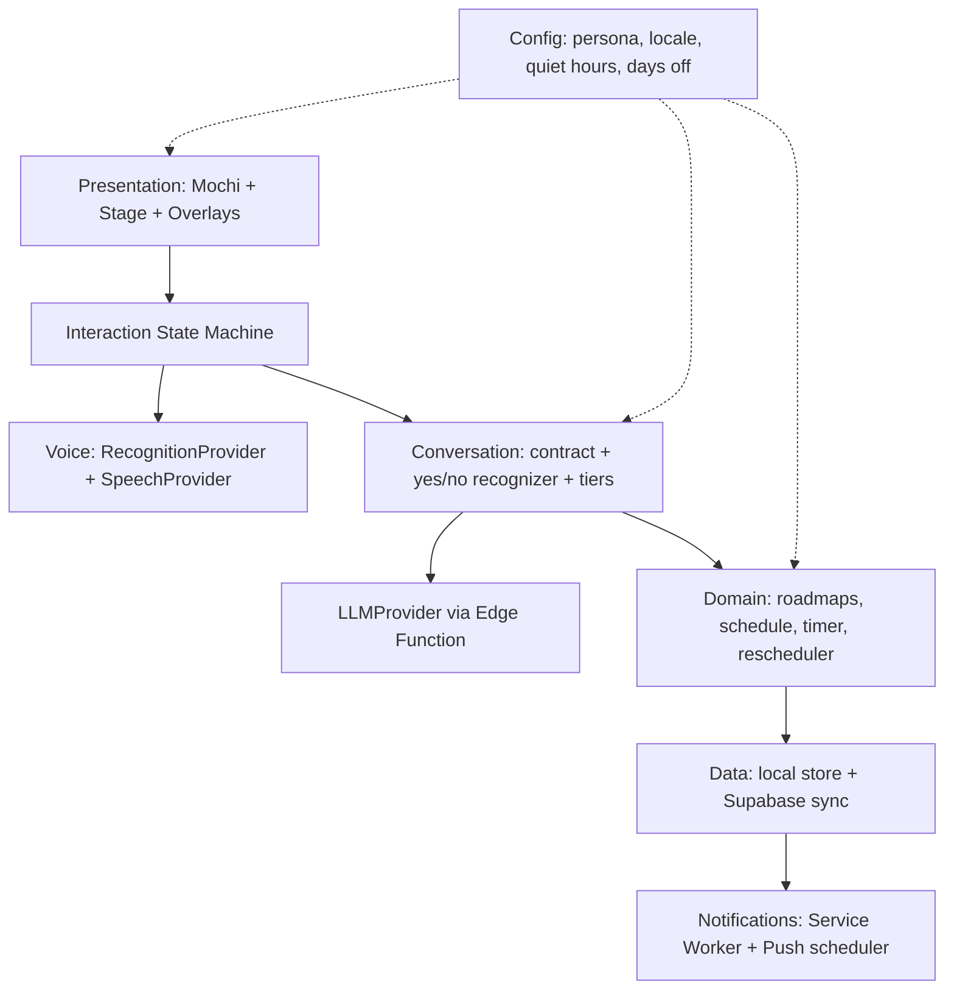

# 🍡 Mochi AI — نطاق المنتج والهندسة (المرحلة 6)

> **الحالة:** مسودة من Claude، ناقصها مراجعة Gemini واعتماد محمود.
> **المصادر:** `00_VISION.md` v1.3، `02_UX_JOURNEY.md`، `02b_NOTIFICATIONS_UX.md`، `03_CHARACTER_MOTION_SPEC.md`، `04_DESIGN_SYSTEM.md`، `05_CONVERSATION_DESIGN.md` v1.2. عند أي تعارض، الرؤية v1.3 هي المرجع.
> الاسم "Mochi" مؤقت وهو قيمة config (`persona.name`).

---

## 1. نطاق النسخة الأولى (v1)

| القدرة | في v1؟ | ملاحظة |
| :-- | :-- | :-- |
| الشاشة الرئيسية: الكاركتر + مؤشر المايك فقط | ✅ | بدون هيدر ولا قوائم |
| الكاركتر: 33 حالة من جدول إعدادات | ✅ | تُبنى الـ 16 الأساسية أولاً |
| التفعيل بلمسة، نافذة متابعة 5 ثواني، إيقاف تلقائي | ✅ | المستوى 1 من الرؤية |
| تعرّف على الكلام (STT) وصوت مصري (TTS) | ✅ | خلف Interfaces، يتأكد في المرحلة 7 |
| كتابة بديلة مخفية + كابشن | ✅ | |
| محادثة بالـ AI مع عقد Zod ومستويات التأكيد | ✅ | |
| الرود ماب، جدول اليوم، تايمر التركيز، مراجعة آخر اليوم | ✅ | التايمر محسوب من timestamps |
| إعادة جدولة مهمة (مشوار مفاجئ / يوم إجازة) | ✅ | منطق بالكود، الموديل بيفهم النية بس |
| ملاحظات صوتية | ✅ | تُحفظ بطلب صريح فقط |
| حسابات ومزامنة لابتوب وموبايل | ✅ | بعد ما الحلقة الأساسية تشتغل محلياً |
| إشعارات Web Push (أندرويد أولاً) | ✅ | مرحلة مستقلة بعد الأساسيات |
| نداء الاسم (المستوى 2) | ⏳ | يتفعّل بعد تجربة الجدوى |
| Mochi يتكلم/يسمع والتطبيق مقفول | ❌ | غير ممكن على الويب |
| iOS للإشعارات | ❌ | بعد v1 |
| الوضع الفاتح | ❌ | الـ tokens جاهزة، بدون اختبار بصري في v1 |
| لغات غير المصري | ❌ | الهيكل يسمح بـ locale packs بعدين |
| Live2D / 3D / مكتبة plugins وقت التشغيل | ❌ | |

## 2. مبادئ هندسية

1. **Local-first:** التطبيق يشتغل بدون نت للحاجات الأساسية، والمزامنة تتضاف فوقه.
2. **التطبيق يقرر، مش الموديل:** حالة الكاركتر، مستوى التأكيد، تنفيذ الإجراءات، والوقت، كلها قرارات التطبيق.
3. **كل خدمة خارجية خلف Interface** (STT، TTS، LLM، التخزين) عشان تتبدل من غير ما نكسر باقي الكود.
4. **المفاتيح والأسرار برا العميل أبداً** (Edge Function فقط).
5. **منطق المجال (domain) بدالات نقية قابلة للاختبار**، ومفيش import من الواجهة جواه.
6. **الإعدادات الشخصية في config مش في الكود** (اسم الشخصية، اللغة، الصوت، ساعات الهدوء، أيام الإجازة).
7. **إمكانية الوصول وتقليل الحركة من أول يوم**، مش إضافة أخيرة.
8. **قابل للتشغيل بنفسك وبدون تكلفة** (القسم 8).

## 3. معمارية الطبقات



| الطبقة | المسؤولية | قواعد |
| :-- | :-- | :-- |
| **Presentation** | مكون الكاركتر (SVG + CSS)، الشاشة الرئيسية، مؤشر المايك، الكابشن، الـ overlays | الحالة البصرية تتحسب من أحداث موثوقة (`03` القسم 11). الكاركتر مبني من جدول إعدادات، ومفيهوش منطق عمل. |
| **Interaction State Machine** | حالات الجلسة (نايم، بيستنى إذن، بيسمع، بيفكر، بيتكلم، متابعة، متوقف، خطأ…) | مصدر الحقيقة لحالة المايك والكاركتر. |
| **Voice** | `RecognitionProvider` و`SpeechProvider` | أي مزود يطبّق نفس الـ Interface. fallback كتابة لو الصوت فشل. الصوت الخام مبيتخزنش. |
| **Conversation** | عقد الاستجابة (Zod)، recognizer للأيوه/لأ، سياسة التأكيد بالـ tiers، `proposal_id` | الـ strict schema يرفض أي حقل غير معرّف. نص المستخدم والمهام بيانات مش تعليمات. |
| **Domain** | الرود ماب، المهام، الجدول، التايمر (من timestamps)، إعادة الجدولة، أيام الإجازة | TypeScript نقي، اختبارات وحدة شاملة، مفيش اعتماد على React. |
| **Data** | store محلي (Zustand + persist) + Supabase (Postgres + RLS) | `updated_at` لكل صف، والمزامنة last-write-wins. |
| **Notifications** | Service Worker + Web Push + مجدول على السيرفر | يعتمد على أن التطبيق يبلّغ السيرفر بمواعيد الجلسات. |
| **Config** | ملف واحد لقيم الشخصية والتفضيلات | يقرأه الجميع، ولا يُكتب في الكود. |

## 4. هيكل الـ Repo

تطبيق واحد (مش monorepo) في البداية، مع حدود واضحة بين الطبقات:

```
mochi-ai/
├── docs/                    ← الخطة والمواصفات (اللي عندنا)
├── src/
│   ├── features/
│   │   ├── character/       ← Mochi: expressions.config + component + gallery
│   │   ├── stage/           ← الشاشة الرئيسية، mic indicator, captions, text fallback
│   │   ├── overlays/        ← timeline, focus, end-of-day, roadmap, notification settings
│   │   └── session/         ← state machine
│   ├── voice/               ← provider interfaces + implementations
│   ├── conversation/        ← schemas (Zod), recognizer, tiers, prompt assembly
│   ├── domain/              ← pure TS: schedule, timer, rescheduler, roadmaps
│   ├── data/                ← store, sync, supabase client
│   ├── notifications/       ← SW registration, subscription, settings
│   ├── config/              ← persona, locale, defaults
│   └── styles/              ← tokens.css
├── supabase/                ← migrations, RLS, edge functions
├── public/                  ← manifest, icons, service worker
├── .github/                 ← CI + issue/PR templates
└── LICENSE · README · CONTRIBUTING · CODE_OF_CONDUCT · SECURITY
```
**قاعدة فرض بالـ lint:** `domain/` و`conversation/` ممنوع يعملوا import من `features/` أو React.

## 5. نقاط التوسّع (للمساهمين)

في v1: **Interfaces فقط**، بدون نظام plugins وقت التشغيل.
- **Providers:** `RecognitionProvider`, `SpeechProvider`, `LLMProvider`, `StorageAdapter`.
- **Expressions:** إضافة تعبير جديد = سطر في `expressions.config` وصفحة المعاينة (gallery) تعرضه تلقائياً.
- **Locale packs:** `ar-EG` الافتراضي، وتوفير هيكل لإضافة لغات (نصوص + recognizer + قواعد الأرقام والوقت).
- **Persona pack:** الاسم والصوت وعبارات الترحيب.
- **Themes:** الـ tokens.

## 6. البيانات (مسودة، تُراجع في M6)

كل الجداول: `id`, `user_id`, `updated_at`, وسياسة RLS `auth.uid() = user_id`.
- `profiles` (إعدادات: persona, locale, quiet_hours, days_off, notification prefs في jsonb)
- `roadmaps`, `roadmap_items` (title, est_minutes, position, status, resource_url?, day_number?)
- `schedule_blocks` (kind, start_at, end_at, status, original_start_at, rescheduled_count)
- `task_sessions` (planned_min, actual_min, overtime_min, checkins)
- `voice_notes` (text فقط)، `day_logs`
- `push_subscriptions`, `scheduled_notifications` (النوع، الموعد، حالة الإلغاء)
- **لا يوجد جدول للصوت الخام.**

## 7. الأمان والخصوصية

- مفاتيح الـ LLM والـ TTS أسرار على السيرفر (Edge Function) فقط.
- RLS على كل جدول، واختبار رفض الوصول لبيانات مستخدم آخر.
- Content-Security-Policy صارمة، وبدون تحليلات (analytics) افتراضياً.
- نص المستخدم والمهام والملاحظات = بيانات، لا تُنفّذ كتعليمات (6 اختبارات حقن في `05`).
- تصدير وحذف بيانات المستخدم من الإعدادات.
- ملف `SECURITY.md` وطريقة للإبلاغ عن الثغرات.
- بيان الخصوصية مكتوب بلغة بسيطة: إيه بيتحفظ وإيه لأ.

## 8. التشغيل والتكلفة (self-host أولاً)

- **نموذج v1:** كل مستخدم (أولهم محمود) يشغّل نسخته: مشروع Supabase مجاني + استضافة ثابتة مجانية (مثل Cloudflare Pages أو Vercel أو Netlify) + مفتاح LLM خاص به كسر في Edge Function.
- لا يوجد "خدمة مستضافة بنفسنا" في v1؛ ممكن تتضاف بعدين.
- **قاعدة التكلفة:** كل خدمة لازم يكون لها بديل مجاني أو قابل للاستبدال، والتطبيق يشتغل (بنسخة محدودة) لو أي مزود وقع.
- **مخاطر معروفة (تتأكد من المصادر الرسمية في المرحلة 7):** حدود الطبقة المجانية للـ LLM بتتغير، وEdge-TTS غير رسمي، ومشاريع Supabase المجانية ممكن تتوقف عند عدم الاستخدام فترة، وحدود الـ Edge Functions على المجدول.

## 9. الجودة والاختبار

| النوع | الأداة | الهدف |
| :-- | :-- | :-- |
| وحدة (Unit) | Vitest | `domain/` و`conversation/`: تغطية عالية، خصوصاً التايمر والجدولة والـ recognizer |
| عقد الـ AI | اختبارات Zod + مجموعة الـ 58 اختبار في `05` | رفض الحقول الغريبة، سلامة الـ tiers |
| بصري | صفحة معاينة (gallery) لـ 33 حالة + لقطات | منع الانحراف عن المواصفات |
| إمكانية الوصول | فحص آلي + قائمة يدوية | AA كحد أدنى، وتقليل الحركة |
| أجهزة | قائمة يدوية على Samsung A51 وHP/Chrome | أداء الأنيميشن، الإشعارات، الصوت |
| CI | GitHub Actions: lint + typecheck + test + build | يفشل البناء لو أي واحد وقع |

## 10. خطة البناء (Milestones)

الأدوار: **Codex** ينفّذ من برومبتات، **Claude** يكتب البرومبتات ويراجع النتيجة، **Gemini** يراجع المطابقة البصرية والأمان. محمود يجرّب ويعتمد قبل أي خطوة جاية.

| # | Milestone | المحتوى | Done when |
| :-- | :-- | :-- | :-- |
| M0 | الأساس | إعداد الـ repo، CI، `tokens.css`، config، LICENSE وملفات المجتمع، حدود الـ lint | `npm run build` + CI أخضر |
| M1 | الكاركتر | مكون Mochi من `expressions.config` (16 حالة أساسية)، صفحة gallery، تقليل الحركة | يطابق صفحة `mochi-states.html` بصرياً، 60fps على A51 (قياس فعلي) |
| M2 | آلة الحالة والشاشة | state machine، الشاشة الرئيسية، مؤشر المايك، الكابشن، الكتابة المخفية (بدون صوت حقيقي، بمحاكاة) | كل رحلات `02` تشتغل بمحاكاة |
| M3 | الصوت الحقيقي | مزودو STT/TTS حسب نتائج المرحلة 7، سلسلة المقاطعة | اختبار 40 جملة من `05` على الأجهزة |
| M4 | المحادثة والمنطق | عقد Zod، recognizer، tiers، Edge Function للـ LLM، التايمر والجدولة والإجازة | اختبارات الـ 58 تنجح |
| M5 | الـ Overlays | الجدول، التايمر، مراجعة اليوم، الرود ماب، إعدادات الإشعارات | مطابقة `mochi-screens.html` |
| M6 | البيانات والمزامنة | حسابات، RLS، مزامنة لابتوب وموبايل | تعديل على جهاز يظهر على التاني، واختبار RLS |
| M7 | الإشعارات | Service Worker، Web Push، المجدول، الإلغاء الذكي | وصول إشعار على A51 والتطبيق مقفول، واحترام الهدوء |
| M8 | جاهزية الاوبن سورس | README، دليل التشغيل الذاتي، CONTRIBUTING، اسم نهائي، فتح الـ repo | شخص غريب يشغّله من الدليل فقط |

## 11. المرحلة 7: تجارب الجدوى (قبل M3 وبالتوازي مع M0 إلى M2)

| # | السؤال | معيار النجاح المقترح |
| :-- | :-- | :-- |
| S1 | دقة التعرف على المصري على Chrome أندرويد (A51) وChrome ويندوز بالـ 40 جملة | أن تُفهم الجمل الواضحة بنسبة مقبولة ويُحدد حد أدنى بعد التجربة، مع خطة بديلة |
| S2 | صوت مصري للـ TTS: الخيارات، الزمن، الترخيص، وإمكانية التشغيل عبر Edge Function | صوت رجالي طبيعي بزمن استجابة مقبول وترخيص يسمح |
| S3 | Web Push على A51 مع توفير بطارية سامسونج | الإشعار يصل في الوقت المقبول والتطبيق مقفول |
| S4 | PWA install وسياسة تشغيل الصوت بعد اللمس | تشغيل الصوت بعد لمسة، وسلوك الـ PWA المثبّتة |
| S5 | نداء الاسم (المستوى 2) | قرار نعم/لا بناءً على دقة وتكلفة وخصوصية |
| S6 | ثبات الـ structured output من الـ LLM المجاني مقابل العقد | نسبة صلاحية الـ JSON مقبولة، مع إعادة محاولة |
| S7 | حدود الطبقة المجانية (Supabase، الـ LLM) للمجدول والاستخدام اليومي | تكفي استخدام مستخدم واحد يومياً |

## 12. الترخيص والحوكمة

- **الكود:** MIT.
- **الاسم والشعار:** الاسم النهائي يتحدد في خطوة مستقلة؛ والاسم والشعار مش مشمولين بترخيص الكود (سياسة علامة تجارية بسيطة).
- ملفات أساسية: `CONTRIBUTING.md`، `CODE_OF_CONDUCT.md`، `SECURITY.md`، قوالب issue وPR.
- مجالات "good first issue": تعبيرات جديدة، locale packs، اختبارات، ترجمات الوثائق.
- Roadmap عام يتحدّث بعد كل milestone.

## 13. خطوة الاسم (قبل فتح الـ repo)

معايير: اسم مصري سهل النطق، يتعرف عليه الـ STT بسهولة (لو هنستخدم النداء)، قصير، غير محجوز كاسم مشروع أو حزمة npm أو دومين أو repo على GitHub، ولا يشبه علامة تجارية معروفة. العملية: قائمة قصيرة من 5 إلى 8 أسماء (منها "نظمي")، تجربة نطق بالمايك فعلياً، وفحص التوفر، وقرار محمود.

## 14. أكبر المخاطر

| الخطر | الأثر | التخفيف |
| :-- | :-- | :-- |
| ضعف التعرف على العامية المصرية | تجربة الصوت تتأثر | S1 مبكراً، وكتابة بديلة، وإمكانية تبديل المزود |
| Edge-TTS غير رسمي | الصوت يقع فجأة | `SpeechProvider` + بدائل + fallback نصي |
| تأخير إشعارات سامسونج | الإشعار يتأخر | S3، وشرح في الإعدادات لتعديل توفير البطارية |
| تغيّر حدود الطبقة المجانية | توقف خدمة | self-host + مفتاح المستخدم + مزودات بديلة |
| 33 حالة بصرية = تضخم | صيانة صعبة | جدول إعدادات، 16 أساسية أولاً، والباقي بحدث حقيقي |
| الاعتماد على Codex بدون مراجعة | جودة غير ثابتة | مراجعة Claude وGemini وCI قبل كل commit مهم |
| فتح الاوبن سورس قبل الأوان | مشاكل أمان | M8 كبوابة: لا يُفتح قبل مراجعة أمان وتنظيف التاريخ من أي أسرار |

## 15. قرارات هذه المرحلة (بالتوصية، لحين اعتماد محمود)

1. **ترخيص MIT** للكود، واسم/شعار خارج الترخيص.
2. **Self-host أولاً** (كل واحد يشغّل نسخته بمفاتيحه)، والخدمة المستضافة بعدين لو احتجنا.
3. **المزامنة والحسابات داخل v1** لكن بعد ما الحلقة الأساسية تشتغل محلياً (M6).
4. **المرحلة 7 (تجارب الجدوى) تشتغل بالتوازي مع M0 إلى M2**، ونتيجتها تحدد M3.
5. **ترتيب البناء** كما في القسم 10، وكل milestone يتقفل باعتماد محمود قبل اللي بعده.
