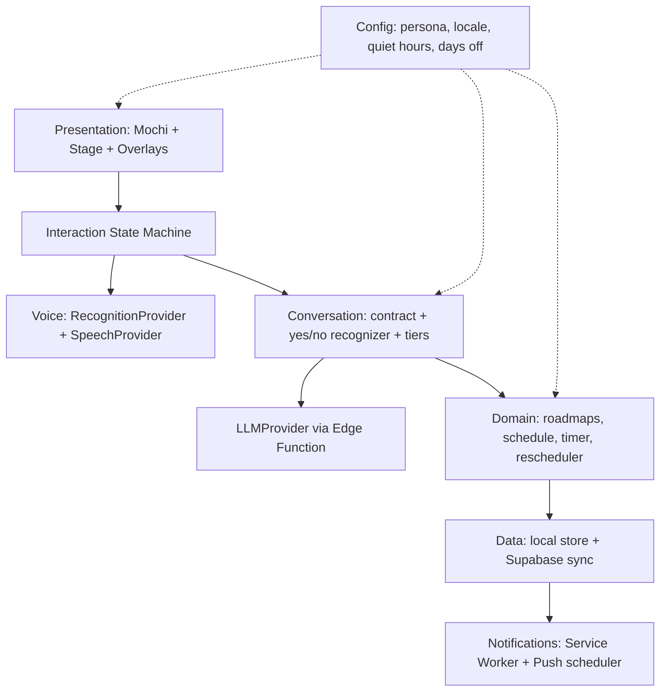

# 🍡 Mochi AI — نطاق المنتج والهندسة (المرحلة 6)

> **الحالة:** v1.1 — اتحدثت بعد مراجعة Gemini (`docs/reviews/06_review_gemini.md`). معتمدة من محمود بنسختها الأولى، والتعديلات دي تحتاج نظرته السريعة.
> **المصادر:** `00_VISION.md` v1.3، `02_UX_JOURNEY.md`، `02b_NOTIFICATIONS_UX.md`، `03_CHARACTER_MOTION_SPEC.md`، `04_DESIGN_SYSTEM.md`، `05_CONVERSATION_DESIGN.md` v1.2. عند أي تعارض، الرؤية v1.3 هي المرجع.
> الاسم "Mochi" مؤقت وهو قيمة config (`persona.name`).

---

## 1. نطاق النسخة الأولى (v1)

| القدرة | في v1؟ | ملاحظة |
| :-- | :-- | :-- |
| الشاشة الرئيسية: الكاركتر + مؤشر المايك فقط | ✅ | بدون هيدر ولا قوائم |
| الكاركتر: 33 حالة من جدول إعدادات | ✅ | تُبنى الـ 16 الأساسية أولاً |
| التفعيل بلمسة، نافذة متابعة 5 ثواني، إيقاف تلقائي | ✅ | المستوى 1 من الرؤية |
| تعرّف على الكلام (STT) وصوت مصري (TTS) | ✅ | خلف Interfaces، يتأكد في المرحلة 7 |
| كتابة بديلة مخفية + كابشن | ✅ | |
| محادثة بالـ AI مع عقد Zod ومستويات التأكيد | ✅ | |
| الرود ماب، جدول اليوم، تايمر التركيز، مراجعة آخر اليوم | ✅ | التايمر محسوب من timestamps |
| إعادة جدولة مهمة (مشوار مفاجئ / يوم إجازة) | ✅ | منطق بالكود، الموديل بيفهم النية بس |
| ملاحظات صوتية | ✅ | تُحفظ بطلب صريح فقط |
| حسابات وعزل بيانات (RLS) | ✅ | من M3، قبل أي استدعاء لخدمة خارجية |
| مزامنة لابتوب وموبايل | ✅ | M7، بعد ما الحلقة الأساسية تشتغل محلياً |
| وضع Demo بدون مفاتيح (مزودين وهميين) | ✅ | يشغّل `npm run dev` بدون حساب ولا مفتاح |
| إشعارات Web Push (أندرويد أولاً) | ✅ | مرحلة مستقلة بعد الأساسيات |
| نداء الاسم (المستوى 2) | ⏳ | يتفعّل بعد تجربة الجدوى |
| Mochi يتكلم/يسمع والتطبيق مقفول | ❌ | غير ممكن على الويب |
| iOS للإشعارات | ❌ | بعد v1 |
| الوضع الفاتح | ❌ | الـ tokens جاهزة، بدون اختبار بصري في v1 |
| لغات غير المصري | ❌ | الهيكل يسمح بـ locale packs بعدين |
| Live2D / 3D / مكتبة plugins وقت التشغيل | ❌ | |

## 2. مبادئ هندسية

1. **Local-first:** التطبيق يشتغل بدون نت للحاجات الأساسية، والمزامنة تتضاف فوقه.
2. **التطبيق يقرر، مش الموديل:** حالة الكاركتر، مستوى التأكيد، تنفيذ الإجراءات، والوقت، كلها قرارات التطبيق.
3. **كل خدمة خارجية خلف Interface** (STT، TTS، LLM، التخزين) عشان تتبدل من غير ما نكسر باقي الكود.
4. **المفاتيح والأسرار برا العميل أبداً** (Edge Function فقط).
5. **منطق المجال (domain) بدالات نقية قابلة للاختبار**، ومفيش import من الواجهة جواه.
6. **الإعدادات الشخصية في config مش في الكود** (اسم الشخصية، اللغة، الصوت، ساعات الهدوء، أيام الإجازة).
7. **إمكانية الوصول وتقليل الحركة من أول يوم**، مش إضافة أخيرة.
8. **قابل للتشغيل بنفسك وبدون تكلفة** (القسم 8).

## 3. معمارية الطبقات



| الطبقة | المسؤولية | قواعد |
| :-- | :-- | :-- |
| **Presentation** | مكون الكاركتر (SVG + CSS)، الشاشة الرئيسية، مؤشر المايك، الكابشن، الـ overlays | الحالة البصرية تتحسب من أحداث موثوقة (`03` القسم 11). الكاركتر مبني من جدول إعدادات، ومفيهوش منطق عمل. |
| **Interaction State Machine** | حالات الجلسة (نايم، بيستنى إذن، بيسمع، بيفكر، بيتكلم، متابعة، متوقف، خطأ…) | مصدر الحقيقة لحالة المايك والكاركتر. |
| **Voice** | `RecognitionProvider` و`SpeechProvider` | أي مزود يطبّق نفس الـ Interface. fallback كتابة لو الصوت فشل. الصوت الخام مبيتخزنش. |
| **Conversation** | عقد الاستجابة (Zod)، recognizer للأيوه/لأ، سياسة التأكيد بالـ tiers، `proposal_id` | الـ strict schema يرفض أي حقل غير معرّف. نص المستخدم والمهام بيانات مش تعليمات. |
| **Domain** | الرود ماب، المهام، الجدول، التايمر (من timestamps)، إعادة الجدولة، أيام الإجازة | TypeScript نقي، اختبارات وحدة شاملة، مفيش اعتماد على React. |
| **Data** | store محلي (Zustand + persist) + Supabase (Postgres + RLS) | `updated_at` لكل صف، والمزامنة last-write-wins. |
| **Notifications** | Service Worker + Web Push + مجدول على السيرفر | يعتمد على أن التطبيق يبلّغ السيرفر بمواعيد الجلسات. |
| **Config** | ملف واحد لقيم الشخصية والتفضيلات | يقرأه الجميع، ولا يُكتب في الكود. |

### 3.1 إضافات بعد المراجعة

1. **ردود النجاح والفشل جاهزة محلياً (بدون استدعاء LLM تاني).** الموديل بيرجّع النية و`proposed_action` وجملة اقتراح (Tier A). بعد ما التطبيق ينفّذ فعلاً ويعرف النتيجة، بيقول **قالب رد حتمي** من `config/locale` (مثل «تمام، بدأنا التايمر. ترجّعها؟»). كده الصدق مضمون، والرد فوري، ومفيش تكلفة ولا زمن إضافي. استدعاء تاني للموديل مش بيحصل في v1 غير لو احتجنا شرح حالة فشل معقدة (نقرر ده في M5).
2. **Context Builder في `conversation/`:** بيجمّع سياق مختصر وموثوق لكل دور: `local_now`، التاريخ، الجلسة النشطة، أقرب 3 مهام، كتل اليوم، `proposal_id` المعلّق، وملخص الإعدادات. المعرّفات والعناوين فقط، بسقف حجم محدد (ميزانية tokens)، وبتنظيف النصوص. ده بيحافظ على الحصة المجانية وبيقلل مساحة الحقن.
3. **دورة حياة الصفحة في `session/`:** عند `visibilitychange` (قفل الشاشة أو التبديل لتطبيق تاني): إيقاف الحركات العشوائية فوراً، وإيقاف جلسة الاستماع، وإرجاع المايك لوضع "متوقف"، وعند العودة إعادة حساب التايمر من فرق الـ timestamps.
4. **حالتين للـ session store:** `pending_proposal` (`proposal_id`, `action`, `created_at`, `expires_at = +60s`, `status`) **في الذاكرة فقط** (لو الصفحة اتعملها reload، المقترح بيتلغي بأمان). و`undo_stack` لآخر عملية مؤكدة فقط (`operation_ref`, `operation_kind`, `previous_state`) **محفوظ محلياً** في IndexedDB ومش بيتزامن.
5. **قاعدة أداء:** ممنوع تمرير `audio-level` عبر React state في كل إطار. بيتحدّث متغيّر CSS (`--audio-level`) مباشرة على عنصر الـ DOM عبر `ref` بمعدل أقصاه 30 مرة في الثانية. الـ 60fps بتتقاس على A51 في M1 (كاركتر وحده) وتتعاد في M4 (مع الصوت).
6. **لما الخدمة السحابية مش متاحة** (مشروع Supabase مجاني متوقف، أو مفيش نت): التطبيق يكمل محلياً، ويظهر رسالة واضحة وغير تقنية (شاشة 10B)، والمزامنة تستأنف لما الخدمة ترجع.
7. **وضع Demo (Zero-Key):** مزودين وهميين للصوت والـ AI بردود مكتوبة مسبقاً، فأي مساهم يشغّل الواجهة والكاركتر في دقايق من غير حساب Supabase ولا مفتاح. بيتبني في M2 ويفضل جزء من الاختبارات.
8. **حل السرعة (لاحقاً لو احتجنا):** أوامر بسيطة ومتكررة («وقّف التايمر»، «مدّ عشر دقايق») ممكن يطابقها matcher محلي من غير ما نكلّم الـ LLM، فنوفر زمن وحصة. القرار بعد قياس S8.

## 4. هيكل الـ Repo

تطبيق واحد (مش monorepo) في البداية، مع حدود واضحة بين الطبقات:

```
mochi-ai/
├── docs/                    ← الخطة والمواصفات (اللي عندنا)
├── src/
│   ├── features/
│   │   ├── character/       ← Mochi: expressions.config + component + gallery
│   │   ├── stage/           ← الشاشة الرئيسية، mic indicator, captions, text fallback
│   │   ├── overlays/        ← timeline, focus, end-of-day, roadmap, notification settings
│   │   └── session/         ← state machine
│   ├── voice/               ← provider interfaces + implementations
│   ├── conversation/        ← schemas (Zod), recognizer, tiers, prompt assembly
│   ├── domain/              ← pure TS: schedule, timer, rescheduler, roadmaps
│   ├── data/                ← store, sync, supabase client
│   ├── notifications/       ← SW registration, subscription, settings
│   ├── config/              ← persona, locale, defaults
│   └── styles/              ← tokens.css
├── supabase/                ← migrations, RLS, edge functions
├── public/                  ← manifest, icons, service worker
├── .github/                 ← CI + issue/PR templates
└── LICENSE · README · CONTRIBUTING · CODE_OF_CONDUCT · SECURITY
```
**قاعدة فرض بالـ lint:** `domain/` و`conversation/` ممنوع يعملوا import من `features/` أو React.

## 5. نقاط التوسّع (للمساهمين)

في v1: **Interfaces فقط**، بدون نظام plugins وقت التشغيل.
- **Providers:** `RecognitionProvider`, `SpeechProvider`, `LLMProvider`, `StorageAdapter`.
- **Expressions:** إضافة تعبير جديد = سطر في `expressions.config` وصفحة المعاينة (gallery) تعرضه تلقائياً.
- **Locale packs:** `ar-EG` الافتراضي، وتوفير هيكل لإضافة لغات (نصوص + recognizer + قواعد الأرقام والوقت).
- **Persona pack:** الاسم والصوت وعبارات الترحيب.
- **Themes:** الـ tokens.

## 6. البيانات (مسودة، تتأكد في M3)

كل الجداول: `id`, `user_id`, **`updated_at` (يكتبه السيرفر بـ trigger)**, **`version int` (يزيد مع كل تعديل)**، وسياسة RLS `auth.uid() = user_id`.

- `profiles`: الإعدادات في jsonb (persona، locale، ساعات الهدوء، أيام الإجازة، تفضيلات الإشعارات).
- `roadmaps`, `roadmap_items`: `title`, `est_minutes`, `position`, `status`, `resource_url?`, `day_number?`.
- `schedule_blocks`: `kind (task|errand|break)`, **`title`** (للمشاوير غير المرتبطة بخطة)، **`roadmap_item_id?`**, `start_at`, `end_at`, `status`, `original_start_at`, `rescheduled_count`.
- `task_sessions`: **`schedule_block_id?`**, **`started_at`, `ended_at`, `status`**, `planned_min`, `actual_min`, `overtime_min`, `checkins`, `clock_source (server|device)`.
- `voice_notes`: نص فقط. `day_logs`.
- `push_subscriptions`: endpoint ومفاتيح الاشتراك لكل جهاز.
- `scheduled_notifications`: `event_key` (مفتاح فريد لمنع التكرار)، `kind`, `due_at`, **`ttl_seconds`**, `payload`, `status (pending|sent|cancelled|expired)`.
- **لا يوجد جدول للصوت الخام.** و`pending_proposal` و`undo_stack` محليين (القسم 3.1).

**المزامنة والوقت:** السيرفر هو اللي يختم `updated_at`، والتعارضات تتحسم بمقارنة `version` (الأعلى يفوز، والخسارة تتسجل)، مش بساعة الجهاز. التايمر بيتحسب من `started_at`؛ وقت بدء الجلسة بيتاخد من السيرفر لو في نت (`clock_source = server`) مع تسجيل فرق الساعة، وغير كده من الجهاز (`device`) ويتعلّم.

## 7. الأمان والخصوصية

- مفاتيح الـ LLM والـ TTS أسرار على السيرفر (Edge Function) فقط.
- RLS على كل جدول، واختبار رفض الوصول لبيانات مستخدم آخر.
- Content-Security-Policy صارمة، وبدون تحليلات (analytics) افتراضياً.
- نص المستخدم والمهام والملاحظات = بيانات، لا تُنفّذ كتعليمات (6 اختبارات حقن في `05`).
- تصدير وحذف بيانات المستخدم من الإعدادات.
- ملف `SECURITY.md` وطريقة للإبلاغ عن الثغرات.
- بيان الخصوصية مكتوب بلغة بسيطة: إيه بيتحفظ وإيه لأ.

**إضافات بعد المراجعة:**
- **الـ Edge Functions ما تتفتحش من غير هوية:** تتحقق من JWT (Supabase Auth) من أول استدعاء في M4 و M5، مع حد أقصى للطلبات لكل مستخدم، وحد لحجم الـ payload، وCORS لنطاق التطبيق فقط. يتحقق من توفر Anonymous Auth في Supabase **[unverified]**؛ البديل تسجيل دخول المالك برابط سحري.
- **CSP محددة:** `default-src 'self'`، و`connect-src` لنطاق Supabase فقط، و`media-src 'self' blob:`، وبدون `unsafe-eval`. تحديث متغيرات CSS من الـ JavaScript (CSSOM) يفترض إنه مش بيتعارض مع CSP **[تتأكد في M0/M1]**.
- **التخزين المحلي:** IndexedDB بدل localStorage للـ store (حد الحجم وحظر الـ main thread)، مع تخزين عبر wrapper لـ Zustand persist.
- **بيان الخصوصية لازم يذكر** إن مزود الـ LLM المجاني ممكن تكون له سياسة استخدام بيانات (تدريب أو مراجعة) **[unverified، يتأكد من توثيق المزود في S6]**، وإن المستخدم يقدر يختار مزود يناسبه.

## 8. التشغيل والتكلفة (self-host أولاً)

- **نموذج v1:** كل مستخدم (أولهم محمود) يشغّل نسخته: مشروع Supabase مجاني + استضافة ثابتة مجانية (مثل Cloudflare Pages أو Vercel أو Netlify) + مفتاح LLM خاص به كسر في Edge Function.
- لا يوجد "خدمة مستضافة بنفسنا" في v1؛ ممكن تتضاف بعدين.
- **قاعدة التكلفة:** كل خدمة لازم يكون لها بديل مجاني أو قابل للاستبدال، والتطبيق يشتغل (بنسخة محدودة) لو أي مزود وقع.
- **مخاطر معروفة (تتأكد من المصادر الرسمية في المرحلة 7):** حدود الطبقة المجانية للـ LLM بتتغير، وEdge-TTS غير رسمي، ومشاريع Supabase المجانية ممكن تتوقف عند عدم الاستخدام فترة، وحدود الـ Edge Functions على المجدول.

### 8.1 مجدول الإشعارات في السيرفر

- **الآلية المقترحة:** جدول `scheduled_notifications` + `pg_cron` يستدعي دالة SQL كل دقيقة تفحص وجود صفوف مستحقة، **ولا تنده على الـ Edge Function (عبر `pg_net`) إلا لو فيه صفوف مستحقة فعلاً**، عشان نوفر حصة الاستدعاءات. **[unverified]** توفر `pg_cron` و`pg_net` وحدود الاستدعاء في الباقة المجانية؛ يتأكد في S7.
- **بديل لو الآلية دي مش مناسبة:** Cron Trigger في خدمة استضافة مجانية (مثل Cloudflare Workers) **[unverified]**.
- **مفاتيح VAPID:** المفتاح العام في الـ config، والخاص سر في الـ Edge Function. سكربت الإعداد بيولّدها مرة واحدة.
- **الإلغاء الذكي:** التطبيق يحدّث الصف (`cancelled`) لما المستخدم يتصرف. ولو كان أوفلاين وفضل الإشعار، السيرفر يفحص **وقت الإرسال** حالة الجلسة وآخر نشاط قبل ما يبعت (خصوصاً "لسه معايا؟")، والـ Service Worker يتحقق من صلاحية الحدث عند اللمس.

## 9. الجودة والاختبار

| النوع | الأداة | الهدف |
| :-- | :-- | :-- |
| وحدة (Unit) | Vitest | `domain/` و`conversation/`: تغطية عالية، خصوصاً التايمر والجدولة والـ recognizer |
| عقد الـ AI | اختبارات Zod + مجموعة الـ 58 اختبار في `05` | رفض الحقول الغريبة، سلامة الـ tiers |
| بصري | صفحة معاينة (gallery) لـ 33 حالة + لقطات | منع الانحراف عن المواصفات |
| إمكانية الوصول | فحص آلي + قائمة يدوية | AA كحد أدنى، وتقليل الحركة |
| أجهزة | قائمة يدوية على Samsung A51 وHP/Chrome | أداء الأنيميشن، الإشعارات، الصوت |
| CI | GitHub Actions: lint + typecheck + test + build | يفشل البناء لو أي واحد وقع |

## 10. خطة البناء (Milestones)

الأدوار: **Codex** ينفّذ من برومبتات، **Claude** يكتب البرومبتات ويراجع النتيجة، **Gemini** يراجع المطابقة البصرية والأمان. محمود يجرّب ويعتمد قبل أي خطوة جاية.

| # | Milestone | المحتوى | Done when |
| :-- | :-- | :-- | :-- |
| M0 | الأساس | الـ repo والأدوات، CI، `tokens.css` **بأسماء Tailwind النظيفة**، خطوط محلية، config، ملفات المجتمع، قاعدة lint للفصل بين الطبقات | `npm run build` + CI أخضر + الصفحة تعرض الخط والألوان |
| M1 | الكاركتر | محرك `expressions.config` يرسم **الـ 33 حالة**، مع بناء الـ 16 الأساسية بصرياً، وصفحة gallery، وتقليل الحركة | يطابق `mochi-states.html`، و60fps على A51 (قياس فعلي) |
| M2 | آلة الحالة والشاشة (وضع Demo) | state machine مع دورة حياة الصفحة، الشاشة الرئيسية، مؤشر المايك، الكابشن، الكتابة المخفية، مزودين وهميين | كل رحلات `02` تشتغل بالمحاكاة |
| M3 | الأساس الخلفي والأمان | مشروع Supabase، migrations وRLS واختباراتها، Auth، هيكل الـ Edge Function (JWT + حد طلبات + حد حجم)، `.env.example` ودليل الإعداد | طلب بدون هوية يترفض، ومستخدم مش بيشوف بيانات غيره |
| M4 | الصوت الحقيقي | مزودو STT/TTS حسب نتائج S1 و S2 و S4 و S8، سلسلة المقاطعة، `audio-level` عبر ref | 40 جملة من `05` على الأجهزة، وزمن الرد مقاس، و60fps مع الصوت على A51 |
| M5 | المحادثة والمنطق | عقد Zod، Context Builder، recognizer، tiers، proposals وundo، قوالب الردود المحلية، الـ LLM عبر الـ Edge Function، التايمر والجدولة والإجازة، وربط حالات الكاركتر الموسّعة (clarifying، confirming، planning، schedule-conflict…) | اختبارات الـ 58 تنجح |
| M6 | الـ Overlays | الجدول، التايمر، مراجعة اليوم، الرود ماب، إعدادات الإشعارات | مطابقة `mochi-screens.html` |
| M7 | المزامنة | store محلي (IndexedDB) ↔ Supabase، تعارضات بالـ `version`، فرق الساعة، حالة `syncing` | تعديل على جهاز يظهر على التاني، واختبار تعارض |
| M8 | الإشعارات | Service Worker، VAPID، المجدول، منع التكرار والإلغاء والتحقق عند الإرسال، حالات الإشعارات في الكاركتر | وصول إشعار على A51 والتطبيق مقفول، واحترام الهدوء والإجازة |
| M9 | جاهزية الاوبن سورس | README، دليل التشغيل الذاتي، وضع Demo موثّق، الاسم النهائي، مراجعة أمان، تنظيف تاريخ الـ Git من أي أسرار | شخص غريب يشغّله بالدليل وحده |

## 11. المرحلة 7: تجارب الجدوى (بالتوازي مع M0 إلى M3، وقبل M4)

| # | السؤال | معيار النجاح المقترح |
| :-- | :-- | :-- |
| S1 | دقة التعرف على المصري على Chrome أندرويد (A51) وChrome ويندوز بالـ 40 جملة | أن تُفهم الجمل الواضحة بنسبة مقبولة ويُحدد حد أدنى بعد التجربة، مع خطة بديلة |
| S2 | صوت مصري للـ TTS: الخيارات، الزمن، الترخيص، وإمكانية التشغيل عبر Edge Function | صوت رجالي طبيعي بزمن استجابة مقبول وترخيص يسمح |
| S3 | Web Push على A51 مع توفير بطارية سامسونج | الإشعار يصل في الوقت المقبول والتطبيق مقفول |
| S4 | PWA install وسياسة تشغيل الصوت بعد اللمس | تشغيل الصوت بعد لمسة، وسلوك الـ PWA المثبّتة |
| S5 | نداء الاسم (المستوى 2) | قرار نعم/لا بناءً على دقة وتكلفة وخصوصية |
| S6 | ثبات الـ structured output من الـ LLM المجاني مقابل العقد | نسبة صلاحية الـ JSON مقبولة، مع إعادة محاولة |
| S7 | حدود الطبقة المجانية (Supabase، الـ LLM) للمجدول والاستخدام اليومي | تكفي استخدام مستخدم واحد يومياً |

**إضافات بعد المراجعة:**
- **S8: زمن الرد الكلي** من انتهاء كلام المستخدم لحد أول صوت من الشخصية (إنهاء التعرّف + بدء الـ Edge Function + استجابة الـ LLM + توليد الصوت) على شبكة حقيقية. هدف مقترح: **وسيط ≤ 3 ثواني وأسوأ حالات ≤ 5 ثواني [هدف، يتأكد بالقياس]**. والتخفيف: حالة "بيفكر" واضحة، وردود محلية للإجراءات المنفّذة، وبث الصوت لو المزود يدعمه.
- **S6 يتوسع:** دعم الـ structured output رسمياً، وحدود RPM/RPD/TPM، وسياسة استخدام البيانات للطبقة المجانية، بالرجوع لتوثيق المزود.
- **S7 يتوسع:** توفر `pg_cron` و`pg_net`، وحدود استدعاء الـ Edge Functions، وسياسة إيقاف المشاريع المجانية عند عدم النشاط وتأثيرها على رسالة العودة بعد غياب، وتوفر Anonymous Auth.

## 12. الترخيص والحوكمة

- **الكود:** MIT.
- **الاسم والشعار:** الاسم النهائي يتحدد في خطوة مستقلة؛ والاسم والشعار مش مشمولين بترخيص الكود (سياسة علامة تجارية بسيطة).
- ملفات أساسية: `CONTRIBUTING.md`، `CODE_OF_CONDUCT.md`، `SECURITY.md`، قوالب issue وPR.
- مجالات "good first issue": تعبيرات جديدة، locale packs، اختبارات، ترجمات الوثائق.
- Roadmap عام يتحدّث بعد كل milestone.

## 13. خطوة الاسم (قبل فتح الـ repo)

معايير: اسم مصري سهل النطق، يتعرف عليه الـ STT بسهولة (لو هنستخدم النداء)، قصير، غير محجوز كاسم مشروع أو حزمة npm أو دومين أو repo على GitHub، ولا يشبه علامة تجارية معروفة. العملية: قائمة قصيرة من 5 إلى 8 أسماء (منها "نظمي")، تجربة نطق بالمايك فعلياً، وفحص التوفر، وقرار محمود.

## 14. أكبر المخاطر

| الخطر | الأثر | التخفيف |
| :-- | :-- | :-- |
| ضعف التعرف على العامية المصرية | تجربة الصوت تتأثر | S1 مبكراً، وكتابة بديلة، وإمكانية تبديل المزود |
| Edge-TTS غير رسمي | الصوت يقع فجأة | `SpeechProvider` + بدائل + fallback نصي |
| تأخير إشعارات سامسونج | الإشعار يتأخر | S3، وشرح في الإعدادات لتعديل توفير البطارية |
| تغيّر حدود الطبقة المجانية | توقف خدمة | self-host + مفتاح المستخدم + مزودات بديلة |
| 33 حالة بصرية = تضخم | صيانة صعبة | جدول إعدادات، 16 أساسية أولاً، والباقي بحدث حقيقي |
| الاعتماد على Codex بدون مراجعة | جودة غير ثابتة | مراجعة Claude وGemini وCI قبل كل commit مهم |
| استنزاف مفتاح الـ LLM عبر Edge Function مفتوحة | تكلفة وأمان | JWT من أول استدعاء + حد طلبات وحجم |
| فرق ساعة الأجهزة في المزامنة | تعديلات تتمسح بالغلط | ختم الوقت من السيرفر + `version` |
| فتح الاوبن سورس قبل الأوان | مشاكل أمان | M8 كبوابة: لا يُفتح قبل مراجعة أمان وتنظيف التاريخ من أي أسرار |

## 15. قرارات هذه المرحلة (بالتوصية، لحين اعتماد محمود)

1. **ترخيص MIT** للكود، واسم/شعار خارج الترخيص.
2. **Self-host أولاً** (كل واحد يشغّل نسخته بمفاتيحه)، والخدمة المستضافة بعدين لو احتجنا.
3. **المزامنة والحسابات داخل v1** لكن بعد ما الحلقة الأساسية تشتغل محلياً (M6).
4. **المرحلة 7 (تجارب الجدوى) تشتغل بالتوازي مع M0 إلى M2**، ونتيجتها تحدد M3.
5. **ترتيب البناء** كما في القسم 10، وكل milestone يتقفل باعتماد محمود قبل اللي بعده.

6. **الحسابات وRLS والأمان الخلفي** قبل أي صوت أو AI حقيقي (M3).
7. **ردود النجاح بقوالب محلية** بدل استدعاء ثاني للموديل. *(هذا القرار يعدّل ما ورد في `05` القسم 7 و9 عن إعادة نتيجة التنفيذ للموديل؛ يتحدّث ملف `05` بتنبيه في أوله، وتُطبّق هذه الوثيقة عند التعارض.)*
8. **وضع Demo بدون مفاتيح** جزء من v1 للمساهمين.

---

## 16. سجل التغييرات (v1 → v1.1، بعد مراجعة Gemini)

- حسابات وRLS وتأمين الـ Edge Functions اتقدّموا لـ M3 (كانوا في M6).
- ردود النجاح والفشل بقوالب محلية، وحذف الاستدعاء الثاني للموديل.
- مجدول الإشعارات اتحدد (آلية، VAPID، إلغاء، التحقق وقت الإرسال).
- ختم الوقت من السيرفر و`version` بدل ساعة الجهاز.
- الجداول اتكملت حقولها، وأضفنا `pending_proposal` و`undo_stack`.
- الأسماء النظيفة للـ tokens في M0، وتوزيع الـ 33 حالة على المراحل.
- قاعدة الأداء لـ `audio-level`، وتجربة S8، وتوسيع S6 و S7.
- Context Builder، دورة حياة الصفحة، التعامل مع توقف Supabase، ووضع Demo.
- ترقيم الـ Milestones من M0 إلى M9 بدل M0 إلى M8.

## 17. ردود على أسئلة Gemini

1. **قوالب الردود:** نعم، قوالب حتمية محلية بعد نجاح التنفيذ (3.1).
2. **المجدول:** `pg_cron` + دالة فحص + `pg_net` عند وجود صفوف مستحقة فقط، مع بديل، ويتأكد في S7 (8.1).
3. **حماية الـ Edge Functions:** JWT من M4، والحساب والـ RLS في M3 (القسم 7 وM3).
4. **مكان `pending_proposal` و`undo_stack`:** المقترح في الذاكرة فقط، والـ undo محلي في IndexedDB (3.1).
5. **فرق الساعة:** السيرفر يختم الوقت، و`version` للتعارض (القسم 6).
6. **الـ 17 حالة الموسّعة:** المحرك في M1، وحالات المحادثة في M5، و`syncing` في M7، وحالات الإشعارات في M8.
